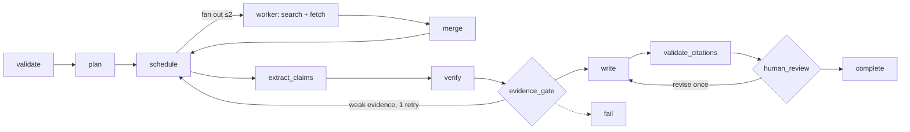
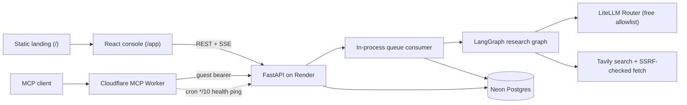

<a id="top"></a>

<div align="center">

# ResearchMind

**Ask a public research question. Get an evidence-linked answer you can check.**

A bounded multi-agent research system: it plans sub-questions, searches the public web,
stores every source and passage, verifies claims against that evidence, and streams
progress live to a React console. A durable Postgres job queue, guest quotas, and a
thin MCP server sit around it.

[](https://github.com/sumitjadhav1703/Multi_agent_research_system/actions/workflows/tests.yml)
[](https://www.python.org/)
[](https://fastapi.tiangolo.com/)
[](https://www.langchain.com/langgraph)
[](https://react.dev/)
[](https://neon.tech/)
[](LICENSE)

[**Live demo**](https://researchmind-console.vercel.app/)
· [Research Console](https://researchmind-console.vercel.app/app/)
· [API health](https://researchmind-api-sg.onrender.com/api/v1/health/ready)
· [MCP server](https://researchmind-mcp.jadhavsumit534.workers.dev/)
· [Engineering story](docs/engineering-story/README.md)

</div>

---

## Contents

- [Highlights](#highlights)
- [How a run works](#how-a-run-works)
- [Architecture](#architecture)
- [Live deployment](#live-deployment)
- [Repository layout](#repository-layout)
- [Getting started](#getting-started)
- [Configuration](#configuration)
- [API reference](#api-reference)
- [MCP server](#mcp-server)
- [Testing and CI](#testing-and-ci)
- [Evaluation](#evaluation)
- [Deployment](#deployment)
- [Security and limits](#security-and-limits)
- [Documentation](#documentation)
- [Contributing](#contributing)
- [License](#license)

---

## Highlights

| | |
| --- | --- |
| **Evidence first** | Every claim in a report links to stored passages and source URLs. Claims are verified as supported, partial or insufficient before the writer sees them. |
| **Bounded by design** | Hard caps on sub-questions (3), parallel workers (2), sources (6), searches (4), model calls (12) and wall-clock time. A run can't run away. |
| **Free-only models** | A LiteLLM Router with a free-model allowlist per role (planner, researcher, verifier, writer), each with a fallback. Paid models make startup fail. |
| **Durable jobs** | Postgres holds jobs, events, quotas, evidence and LangGraph checkpoints. Runs survive restarts, and a crashed job's lease is recovered. |
| **Live progress** | REST for commands, Server-Sent Events for replayable progress. A refresh replays saved events. |
| **Human in the loop** | Every report pauses for review: approve, request one revision, or reject. |
| **Abuse limits** | One-use guest identities behind Cloudflare Turnstile, global active and daily caps, and SSRF-checked page fetching. |
| **MCP access** | A Cloudflare Worker exposes the same runs as MCP tools by forwarding to the API. It does not run its own research. |

---

## How a run works



1. **Plan.** The planner model splits the question into up to 3 sub-questions with search queries.
2. **Research.** Workers run in parallel (max 2). Each searches Tavily, fetches up to 2 pages through the SSRF-checked fetcher, and stores sources and passages.
3. **Extract and verify.** The researcher model pulls claims that cite passage IDs. The verifier model rates each claim against its quoted evidence.
4. **Evidence gate.** If evidence is too thin, one follow-up search runs, but only when source slots are free and only for new URLs.
5. **Write.** The writer produces a cited report, and citations are checked against the evidence ledger.
6. **Review.** The run pauses as `review_required` until a person approves, revises once, or rejects.

Final statuses: `completed`, `failed`, `cancelled`, `expired` (wall-clock limit), `rejected`.

---

## Architecture



- **One process, one consumer.** The API runs one Uvicorn worker. The queue consumer runs in the FastAPI lifespan, leases jobs from Postgres, and runs the graph. New runs, reviews and cancels wake it at once. When idle it checks only every `QUEUE_IDLE_POLL_SECONDS` (300 s), so Neon can scale to zero.
- **Postgres is the source of truth** for jobs, events, idempotency keys, quotas, evidence and checkpoints. Nothing important lives only in memory.
- **Secrets stay server-side.** No key is in the frontend bundle or the logs.
- **Self-healing boot.** If the database is unreachable at startup, the API keeps retrying in the background (5 s backoff, up to 60 s) instead of staying down.

---

## Live deployment

| Surface | Host | URL |
| --- | --- | --- |
| Landing + Research Console | Vercel | https://researchmind-console.vercel.app (`/` landing, `/app` console) |
| API | Render Free, Singapore | https://researchmind-api-sg.onrender.com |
| MCP server | Cloudflare Workers | https://researchmind-mcp.jadhavsumit534.workers.dev |
| Database | Neon Postgres, `aws-ap-southeast-1` | Private (`DATABASE_URL` on Render) |

```bash
curl -fsS https://researchmind-api-sg.onrender.com/api/v1/health/live
curl -fsS https://researchmind-api-sg.onrender.com/api/v1/health/ready
```

> Render Free sleeps when idle. A Cloudflare cron pings the API every 10 minutes to keep it warm, but a cold start can still take up to a minute. This is a portfolio demo, not a service with an SLA.

**Try it:** open the [console](https://researchmind-console.vercel.app/app/), pass the Turnstile check, and ask one public, non-sensitive question. Watch the live run, then open **Report** and **Evidence**. Each guest identity gets one run.

---

## Repository layout

```text
backend/                FastAPI API (Python 3.13)
  app/api/v1/           HTTP routes: guest, runs, SSE stream, reads, usage, health
  app/graph/            LangGraph nodes, builder, runner, prompts, limits
  app/research/         Evidence ledger, Tavily retrieval, safe page fetch
  app/providers/        LiteLLM Router, model client, mock provider
  app/jobs/             Queue consumer, leases, quotas, persistence, retention
  app/security/         SSRF egress helper
  app/db/               SQLAlchemy models, engine, migration runner
  migrations/           SQL migrations (applied at boot)
  tests/                Offline unit and integration tests
frontend/               React + Vite Research Console (served at /app)
  landing/              Static landing page (served at /)
mcp-server/             Cloudflare Worker MCP server
evals/                  Offline golden dataset, deterministic checks, DeepEval judge
docs/                   ADRs, engineering story, eval results, status, risks
infra/                  Docker entrypoint
scripts/                Offline test matrix
v1/                     Frozen V1 Streamlit app (not deployed)
.github/workflows/      CI, MCP deploy, manual keep-awake
Dockerfile · render.yaml · vercel.json · .env.example
```

---

## Getting started

**Prerequisites:** Python 3.13 (3.15 can't build LiteLLM's native deps yet), Node.js 24, npm. Postgres and Docker are optional: SQLite works locally.

### 1. Backend

```bash
git clone https://github.com/sumitjadhav1703/Multi_agent_research_system.git
cd Multi_agent_research_system

python3.13 -m venv .venv && source .venv/bin/activate
pip install -r backend/requirements.txt
cp .env.example .env   # never commit .env
```

For an offline run with no keys, set these in `.env`:

```bash
USE_MOCK_PROVIDER=true
DATABASE_URL=sqlite:///./local.db
QUEUE_CONSUMER_ENABLED=true
```

```bash
PYTHONPATH=. uvicorn backend.app.main:app --reload --port 8000
curl -fsS http://127.0.0.1:8000/api/v1/health/ready
```

> The mock provider checks the plumbing (API, queue, SSE, quotas). It can't produce a real research plan, so a mock run ends as `failed`. For real runs, add provider keys and `TAVILY_API_KEY` and set `USE_MOCK_PROVIDER=false`.
>
> Guest sign-up needs `TURNSTILE_SECRET_KEY`. With no secret, the API rejects every guest. For local testing, use Cloudflare's published always-pass test secret `1x0000000000000000000000000000000AA`.

### 2. Frontend

```bash
cd frontend
npm ci
npm run dev        # landing: http://127.0.0.1:5173/  console: http://127.0.0.1:5173/app/
```

Leave `VITE_API_BASE` empty to use the Vite proxy to `127.0.0.1:8000`. See `frontend/.env.example`.

### 3. MCP server (optional)

```bash
cd mcp-server
npm ci
npm test
npm run dev        # set RESEARCHMIND_API_BASE in .dev.vars (see .dev.vars.example) to use a local API
```

---

## Configuration

All backend settings are environment variables, read by `backend/app/core/config.py`. The full annotated list is in [`.env.example`](.env.example).

| Variable | Purpose |
| --- | --- |
| `DATABASE_URL` | Postgres (Neon) or `sqlite:///…` connection string |
| `USE_MOCK_PROVIDER` | `true` for offline and CI, `false` for real models |
| `ALLOW_PAID_MODELS` | Must stay `false`. Startup fails if a paid model is configured. |
| `FREE_MODEL_ALLOWLIST` | Comma-separated LiteLLM model ids every role model must match |
| `PLANNER_* / RESEARCH_* / VERIFIER_* / WRITER_*_MODEL` | Primary and fallback model per role |
| `GROQ_API_KEY`, `OPENROUTER_API_KEY` | Free provider keys (Groq primaries; OpenRouter Nemotron verifier and fallbacks). `NVIDIA_NIM_API_KEY` is optional (supported, not a default). |
| `LLAMA_API_KEY` (or `META_API_KEY`) | Meta Muse paid last resort |
| `TAVILY_API_KEY` | Web search |
| `META_LAST_RESORT_ENABLED` | Paid Meta Muse last resort (owner-approved, `true` in production). Runs only when a role's free primary and fallback both fail; its model must be allowlisted. |
| `TURNSTILE_SECRET_KEY` | Verifies guest sign-up |
| `CORS_ORIGINS` | Exact console origins, comma-separated. These hosts are also the only accepted Turnstile hostnames. |
| `GLOBAL_MAX_ACTIVE_RUNS` / `GLOBAL_DAILY_RUN_CAP` | Demo load caps |
| `MAX_MODEL_CALLS_PER_RUN` / `MAX_RUN_WALL_CLOCK_SECONDS` | Per-run budgets (model calls are capped at 12 regardless) |
| `QUEUE_POLL_SECONDS` / `QUEUE_IDLE_POLL_SECONDS` | Busy and idle queue polling intervals |
| `DATA_RETENTION_DAYS` | Old runs and stale reviews are purged after this many days |

Frontend (public, build time): `VITE_API_BASE` (API origin) and `VITE_TURNSTILE_SITE_KEY`. Never put a secret in a `VITE_` variable.

---

## API reference

Base path `/api/v1`. Everything except health and guest sign-up needs `Authorization: Bearer <guest_token>`.

| Method | Path | Purpose |
| --- | --- | --- |
| `GET` | `/health/live` | Process is up (no DB call) |
| `GET` | `/health/ready` | DB reachable: `status`, `database`, `use_mock_provider` |
| `POST` | `/guest-identities` | Exchange a Turnstile token for a guest token |
| `POST` | `/research-runs` | Start a run. Needs an `Idempotency-Key` header and returns `202` with the queued run. |
| `GET` | `/research-runs/{id}` | Run snapshot: status, budgets, usage |
| `GET` | `/research-runs/{id}/events` | Saved events (replay) |
| `GET` | `/research-runs/{id}/events/stream` | Live SSE stream, with `Last-Event-ID` resume |
| `POST` | `/research-runs/{id}/approve` · `/revise` · `/reject` | Review a paused run |
| `POST` | `/research-runs/{id}/cancel` | Cancel a run |
| `GET` | `/research-runs/{id}/report` | Final report |
| `GET` | `/research-runs/{id}/sources` | Sources and passages |
| `GET` | `/research-runs/{id}/claims/{claim_id}/evidence` | Evidence behind one claim |
| `GET` | `/me/usage` | Quota meters and usage ledger totals |
| `GET` | `/evaluation/summary` | Published offline evaluation snapshot |

Interactive docs: `/docs` on any running API.

---

## MCP server

The Worker at `https://researchmind-mcp.jadhavsumit534.workers.dev/mcp` exposes six tools. Each forwards to the API with the caller's guest bearer token.

| Tool | Does |
| --- | --- |
| `create_research_run` | Start a run |
| `get_research_run` | Status and snapshot |
| `get_research_report` | Final report |
| `list_research_sources` | Sources for a run |
| `get_claim_evidence` | Evidence for a claim |
| `get_evaluation_summary` | Published eval snapshot |

Details: [`mcp-server/README.md`](mcp-server/README.md).

---

## Testing and CI

```bash
scripts/run_offline_suites.sh                       # V1 + backend + evals (mock provider, SQLite)
RUN_NODE_SUITES=1 scripts/run_offline_suites.sh     # plus frontend and MCP
```

Or each suite on its own:

```bash
USE_MOCK_PROVIDER=true DATABASE_URL= QUEUE_CONSUMER_ENABLED=false TURNSTILE_SECRET_KEY= \
  PYTHONPATH=. python -m unittest discover -s backend/tests      # backend
PYTHONPATH=. python -m unittest discover -s evals/tests            # evals
cd v1 && python -m unittest discover -s tests                     # frozen V1
cd frontend && npm run lint && npm run typecheck && npm test && npm run build
cd mcp-server && npm test
```

[GitHub Actions](.github/workflows/tests.yml) runs six jobs on every push and PR: `v1`, `backend` (with `pip check`), `evals`, `mcp`, `docker` (image build) and `frontend`.

| Suite | Tests (2026-11-10) |
| --- | --- |
| Backend | 228 |
| Frontend | 47 |
| MCP Worker | 31 |
| V1 | 16 |
| Evals | 15 |

Postgres-only behaviour (`FOR UPDATE SKIP LOCKED` leasing) has a test that runs only when a real Postgres URL is provided; CI uses SQLite.

---

## Evaluation

An offline harness scores hand-built fixture runs from a 32-case golden dataset (`golden-v0.1`). These are fixture scores, not scores of live research runs.

| Check | Result |
| --- | --- |
| Deterministic fixture checks | 20/20 matched |
| Faithfulness (mean) | 0.925 (n=20) |
| Answer relevancy (mean) | 0.700 (n=20) |
| Contextual precision (mean) | 0.833 (n=18) |
| Contextual recall (mean) | 0.667 (n=18) |
| Judge | DeepEval with `meta/muse-spark-1.3-contributor`, 80 scores, 0 errors |
| V1 vs V2 comparison | Not measured |

```bash
PYTHONPATH=. python -m evals.cli deterministic
RM_EVAL_JUDGE=1 PYTHONPATH=. python -m evals.cli judge --confirm-offline   # needs evals/requirements.txt and a judge key
```

[`docs/evals/published-summary.json`](docs/evals/published-summary.json) is the only source for these numbers. The console Evaluation page, the API and the MCP tool all read it. Write-up: [`docs/evals/RESULTS.md`](docs/evals/RESULTS.md).

---

## Deployment

| Target | How it deploys | Config |
| --- | --- | --- |
| **API** (Render) | Auto-deploys on push to `main`. Docker image, one worker, migrations run at boot. | [`render.yaml`](render.yaml), [`Dockerfile`](Dockerfile), [`infra/docker-entrypoint.sh`](infra/docker-entrypoint.sh) |
| **Console** (Vercel) | Auto-deploys on push to `main`. Vite builds `/app` and copies the landing page to `/`. | [`vercel.json`](vercel.json) |
| **MCP server** (Cloudflare) | A GitHub Action deploys on pushes that touch `mcp-server/**`. | [`deploy-mcp-worker.yml`](.github/workflows/deploy-mcp-worker.yml), [`wrangler.jsonc`](mcp-server/wrangler.jsonc) |

**Secrets are never in git.** Set them in each dashboard:

| Where | Secrets |
| --- | --- |
| Render | `DATABASE_URL`, provider keys, `TAVILY_API_KEY`, `TURNSTILE_SECRET_KEY`, `CORS_ORIGINS` |
| Vercel | `VITE_API_BASE`, `VITE_TURNSTILE_SITE_KEY` |
| GitHub Actions | `CLOUDFLARE_API_TOKEN`, `CLOUDFLARE_ACCOUNT_ID` |

Keep `WEB_CONCURRENCY=1`: each Uvicorn worker would start its own queue consumer, so the entrypoint refuses any other value.

More: [`docs/deployment-report.md`](docs/deployment-report.md).

---

## Security and limits

| Topic | Position |
| --- | --- |
| Quotas | One run per guest identity. Global active and daily caps are enforced in Postgres with conditional updates. |
| Providers | Free allowlist only. A paid model or `ALLOW_PAID_MODELS=true` makes startup fail. |
| Secrets | Server-side only. Log fields are redacted. |
| Turnstile | Guest sign-up requires it. The response's hostname must match `CORS_ORIGINS`. |
| SSRF | Page fetches resolve DNS, block private addresses, and connect to the checked IP with an overall read deadline. **Not fully closed:** there is no separate egress proxy (risk R04). |
| Data | Public topics only. Runs are deleted after the retention window. |
| Hosting | Free tiers. Cold starts happen, and there is no SLA. |

Open risks and known issues are tracked in [`docs/RISK_REGISTER.md`](docs/RISK_REGISTER.md) and [`docs/BUG_INVENTORY.md`](docs/BUG_INVENTORY.md).

---

## Documentation

| Doc | What it covers |
| --- | --- |
| [`AGENTS.md`](AGENTS.md) | Full guide for working on this repo (start here) |
| [`docs/engineering-story/`](docs/engineering-story/README.md) | Design narrative: pipeline, retrieval, streaming, cost, security, evaluation |
| [`docs/ADR/`](docs/ADR/) | Architecture decision records |
| [`docs/RISK_REGISTER.md`](docs/RISK_REGISTER.md) · [`docs/BUG_INVENTORY.md`](docs/BUG_INVENTORY.md) | Open risks and bugs |
| [`docs/TEST_INVENTORY.md`](docs/TEST_INVENTORY.md) | What each test suite covers |
| [`docs/deployment-report.md`](docs/deployment-report.md) | Hosts and deploy checks |
| [`docs/IMPLEMENTATION_STATUS.md`](docs/IMPLEMENTATION_STATUS.md) | Milestone history |
| [`docs/RESEARCHMIND_2_0_SOURCE_OF_TRUTH.md`](docs/RESEARCHMIND_2_0_SOURCE_OF_TRUTH.md) | Original 2.0 spec |
| [`v1/README.md`](v1/README.md) | The frozen V1 Streamlit app |

---

## Contributing

1. Branch from `main` and use Python 3.13.
2. Never commit `.env` or any secret.
3. Run the relevant suites (see [Testing and CI](#testing-and-ci)) before opening a PR; CI must be green.
4. When behaviour changes, update the docs that describe it, with real command output and not assumed results.

Issues: https://github.com/sumitjadhav1703/Multi_agent_research_system/issues

---

## License

[MIT](LICENSE)

<div align="center">

[Back to top](#top)

</div>
