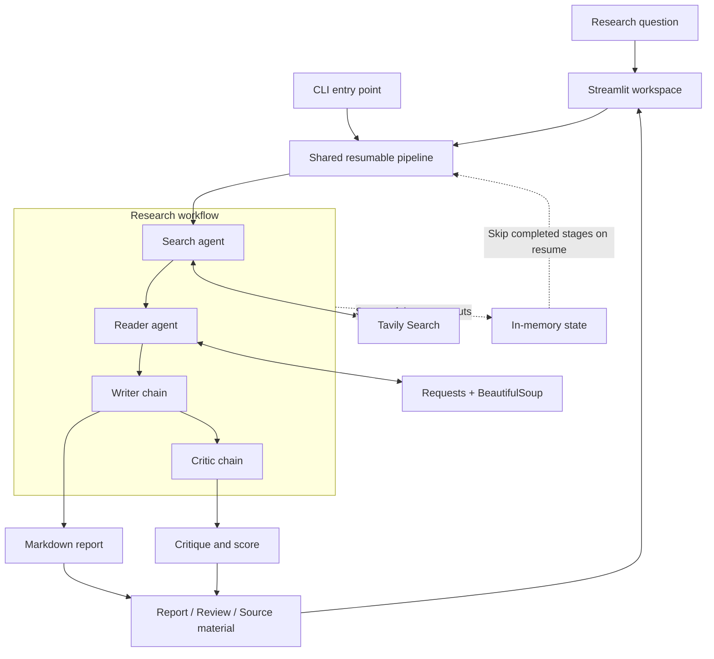

<a id="top"></a>

<div align="center">

# 🧠 ResearchMind

### From a research question to a structured first draft.

A multi-agent research workspace that searches the web, reads source material,<br>
writes a report, and reviews the draft—all in one Streamlit interface.

[](https://www.python.org/)
[](https://streamlit.io/)
[](https://www.langchain.com/)
[](https://console.groq.com/)
[](https://github.com/sumitjadhav1703/Multi_agent_research_system/actions/workflows/tests.yml)
[](LICENSE)

[**Open the app →**](https://multiagentresearchsystem-f47mjoqmqw8nlxf8uud5v2.streamlit.app/)
&nbsp; · &nbsp; [Quick start](#quick-start)
&nbsp; · &nbsp; [Architecture](#architecture)
&nbsp; · &nbsp; [Deployment](#deployment)
&nbsp; · &nbsp; [Report an issue](https://github.com/sumitjadhav1703/Multi_agent_research_system/issues)

</div>

---

## Overview

Researching a new topic usually means moving between search results, source
pages, notes, and a writing tool. ResearchMind brings those steps into a single,
inspectable workflow: enter a question, follow the agents' progress, then read
the report alongside its critique and source material.

The system uses **two tool-using agents** for search and reading, followed by
**two model chains** for writing and critique. Each stage has a distinct role,
and successful outputs are saved before the next stage begins. If a provider
request fails, the Streamlit workspace can resume from the unfinished stage.

Use it for technical exploration, literature discovery, and early research
drafts. Reports and critic scores require human review; the pipeline does not
independently verify every claim.

## Contents

- [Features](#features)
- [Architecture](#architecture)
- [Technology stack](#technology-stack)
- [Quick start](#quick-start)
- [Using the workspace](#using-the-workspace)
- [Reliability and recovery](#reliability-and-recovery)
- [Deployment](#deployment)
- [Testing and development](#testing-and-development)
- [Project structure](#project-structure)
- [Troubleshooting](#troubleshooting)
- [Security and operational limits](#security-and-operational-limits)
- [Contributing](#contributing)
- [License](#license)

## Features

| Capability | What it provides |
| --- | --- |
| **Web discovery** | Tavily search results with titles, URLs, and bounded snippets. |
| **Source reading** | A reader agent instructed to select one relevant public HTML page and summarize its extracted text. |
| **Structured reports** | A writer prompted to produce an introduction, findings, limitations, conclusion, and source links. |
| **Constructive critique** | A separate review pass for clarity, attribution, caveats, and unsupported claims. |
| **Visible progress** | Ordered Search, Read, Write, and Review stages with waiting, working, complete, and paused states. |
| **Resumable sessions** | Explicit recovery from unfinished stages while retaining completed work in the current session. |
| **Report workspace** | Separate Report, Critic review, and Source material tabs in a responsive dark/orange interface. |
| **Markdown export** | Download a report as soon as writing finishes, even if the critic is paused. |
| **CLI access** | The same orchestration is available through a command-line entry point. |

## Architecture



All four stages use **`openai/gpt-oss-20b` served by Groq**. Search and Reader
use LangChain's tool-calling agent interface; Writer and Critic combine prompt
templates, a chat model, and a string output parser. The critic is a separate
prompted pass using the same model, not an independent fact-checking service.

| Stage | Input | Output |
| --- | --- | --- |
| **Search** | User's research topic | Findings and source URLs from Tavily results. |
| **Read** | Topic and saved search output | Summary of extracted source text, or an extraction limitation. |
| **Write** | Topic, search findings, and reader output | A source-linked Markdown research draft. |
| **Review** | Saved report | Strengths, improvement areas, a score, and a verdict. |

## Technology stack

| Layer | Technology |
| --- | --- |
| Runtime | Python 3.13 |
| Interface | Streamlit, custom CSS, native session state |
| Agent orchestration | LangChain and LangGraph |
| Model inference | Groq via `langchain-groq` |
| Search | Tavily Search API |
| HTML extraction | Requests and BeautifulSoup |
| Configuration | Environment variables, `python-dotenv`, Streamlit secrets |
| Validation | Python `unittest`, Streamlit AppTest, GitHub Actions |

Resolved package versions are pinned in [`requirements.txt`](requirements.txt).
Direct dependencies are listed in [`requirements.in`](requirements.in).

## Quick start

### 1. Clone and create an environment

Prerequisites: **Git**, **Python 3.13**, and API access to **Groq** and **Tavily**.

```bash
git clone https://github.com/sumitjadhav1703/Multi_agent_research_system.git
cd Multi_agent_research_system
python3.13 -m venv .venv
```

Activate the environment:

```bash
# macOS / Linux
source .venv/bin/activate
```

```powershell
# Windows PowerShell — create the environment with: py -3.13 -m venv .venv
.\.venv\Scripts\Activate.ps1
```

### 2. Install dependencies

```bash
python -m pip install -r requirements.txt
```

### 3. Configure API access

Copy [`.env.example`](.env.example) to `.env` in the repository root and replace
the placeholder values:

```dotenv
GROQ_API_KEY=your_groq_key
TAVILY_API_KEY=your_tavily_key
```

| Variable | Purpose | Provider |
| --- | --- | --- |
| `GROQ_API_KEY` | Model inference for all research stages. | [Groq Console](https://console.groq.com/) |
| `TAVILY_API_KEY` | Web search for the Search agent. | [Tavily](https://tavily.com/) |

Keep both keys on the server. `.env` and `.streamlit/secrets.toml` are excluded
from version control. The landing page can load without credentials, but
research stays disabled until both keys are present.

### 4. Launch the application

```bash
streamlit run app.py
```

Open the local address printed in your terminal, typically
[localhost:8501](http://localhost:8501).

## Using the workspace

1. Enter a focused topic, or select an example to fill the input.
2. Select **Start research** and follow the four stage indicators.
3. Open **Report** to read the draft, **Critic review** for feedback, and
   **Source material** to inspect the search and reader outputs.
4. Select **Download report** to save the Markdown file.
5. If a stage pauses, resolve the reported condition and select
   **Resume unfinished stages** after any cooldown.

Example questions:

- How are AI agents being evaluated?
- What are the main barriers to practical fusion energy?
- Which deployment challenges affect retrieval-augmented generation systems?

### Command-line usage

```bash
python pipeline.py
```

Enter a topic when prompted. The CLI prints stage progress, the report, and the
critique. If review fails after writing succeeds, it prints the saved draft
before exiting with a failure status. CLI state lasts only for that process.

<details>
<summary><strong>Programmatic usage and saved state</strong></summary>

```python
from pipeline import PipelinePaused, run_research_pipeline

state = {}
topic = "How are AI agents being evaluated?"

try:
    result = run_research_pipeline(topic, state)
    print(result["report"])
    print(result["feedback"])
except PipelinePaused as exc:
    print(f"Paused at {exc.stage}: {exc}")
    print(f"Cooldown: {exc.retry_after} seconds")
    if "writer" in state:
        print(state["writer"])
    # Keep state. After resolving the error and respecting the cooldown,
    # call run_research_pipeline(topic, state) again for the SAME topic.
```

The return dictionary contains `search_results`, `scraped_content`, `report`,
and `feedback`. The mutable stage-state dictionary uses `search`, `reader`,
`writer`, and `critic`. A caller must keep state paired with its original topic
and enforce the cooldown; the pipeline itself does not sleep or schedule retries.

</details>

## Reliability and recovery

The pipeline saves each completed stage before moving forward. A Groq rate
limit pauses work with a safe message instead of exposing a raw traceback.
The UI honors the provider's `Retry-After` header, falling back to 60 seconds
when the value is missing or invalid. Recovery requires an explicit action;
SDK retries are disabled.

**For example:** if the critic is rate-limited, the written report remains
readable and downloadable. Resuming runs the critic against that report;
search, reading, and writing are skipped. Ordinary Streamlit reruns do not
start new model requests.

| Bound | Current implementation |
| --- | --- |
| Research topic | 1–500 characters after trimming. |
| Search results | Up to 5 results per Tavily tool call. |
| Agent execution | Recursion limit of 8 for Search and Reader. |
| Model output | `max_tokens=1200` for Search, Reader, and Critic; `2200` for Writer. |
| Model requests | 45-second configured timeout; SDK retries disabled. |
| Source extraction | Response-size check at 1,000,000 bytes; up to 6,000 extracted text characters. |
| Downstream context | Up to 6,000 characters each from Search and Reader for writing; 16,000 report characters for critique. |

These bounds control individual calls and agent execution. They do not provide
a shared usage budget across users or workers. Groq's organization-level
quotas still apply, and daily limits can outlast the fallback cooldown.
See [Groq account limits](https://console.groq.com/settings/limits) and
[rate-limit documentation](https://console.groq.com/docs/rate-limits).

**Session lifetime:** results belong to the current browser session. Starting
new research replaces them; session expiry, a new session, or a server restart
can lose them. Editing the topic field does not change the topic of a resumed
run. Download any report you want to keep.

## Deployment

### Streamlit Community Cloud

1. Connect this repository and select the intended deployment branch.
2. Set the entry point to **`app.py`** and select **Python 3.13**.
3. Add these root-level entries under **App settings → Secrets**:

   ```toml
   GROQ_API_KEY = "your_groq_key"
   TAVILY_API_KEY = "your_tavily_key"
   ```

4. Deploy with the committed `requirements.txt`. The repository includes its
   dark theme in [`.streamlit/config.toml`](.streamlit/config.toml).
5. After a rebuild, confirm the landing page loads and run a small research
   query with your own credentials. Check the report, critique, and download.

Reboot the app if a merged update has not appeared. A Python-version change may
require redeployment. Local mocked tests do not establish hosted provider
availability, quota headroom, or report quality.

## Testing and development

Run the offline suite from the repository root:

```bash
python -m unittest discover -s tests -v
```

The suite mocks external services and covers:

- Report preservation after a critic rate limit and critic-only resume.
- Cooldown enforcement and prevention of duplicate calls on ordinary reruns.
- Recovery of interrupted work and validation of empty or oversized topics.
- Startup without API keys and clickable topic examples.
- Public-URL validation, blocked private-network redirects, and HTML extraction.

[GitHub Actions](.github/workflows/tests.yml) runs the suite on Python 3.13 for
pushes and pull requests. It does not run paid/live provider smoke tests.

To update dependencies intentionally, install `uv`, edit `requirements.in`,
resolve the pins, and rerun the suite:

```bash
uv pip compile requirements.in --python 3.13 -o requirements.txt
python -m pip install -r requirements.txt
python -m unittest discover -s tests -v
```

## Project structure

```text
Multi_agent_research_system/
├── app.py                      # Streamlit workspace and session recovery
├── agents.py                   # Groq agent builders and report/review chains
├── pipeline.py                 # Shared orchestration and CLI entry point
├── tools.py                    # Search and bounded public-web extraction
├── style.css                   # Responsive dark/orange interface styles
├── requirements.in             # Direct dependencies
├── requirements.txt            # Resolved dependency pins
├── .env.example                # API-key template; contains no real secrets
├── .streamlit/
│   └── config.toml             # Streamlit theme and telemetry preference
├── .github/workflows/
│   └── tests.yml               # Offline CI
├── tests/
│   ├── test_app.py             # Streamlit interactions and recovery
│   ├── test_pipeline.py        # Saved stages, failures, and validation
│   └── test_tools.py           # URL validation and extraction
├── docs/
│   └── repair-plan.md          # Reliability and interface change scope
├── LICENSE
└── README.md
```

## Troubleshooting

| Symptom | What to check |
| --- | --- |
| **Start research is disabled** | Configure both API keys in `.env` locally or root-level Streamlit secrets in Cloud. |
| **Groq usage limit reached** | Wait for the cooldown, then resume. For persistent limits, check your organization's quota and other workloads using it. |
| **Groq rejects the API key** | Check the server's `GROQ_API_KEY`, replace it if needed, and restart or reboot after updating configuration. |
| **Search stage pauses** | Check Tavily credentials, quota, and connectivity, then resume. |
| **A source cannot be extracted** | Protected, oversized, or non-HTML pages may fail. Inspect source material and report caveats; snippets may be used instead. |
| **Critic is pending but the report exists** | Download the draft now and resume review after resolving the provider issue. |
| **Saved work disappeared** | Session state is temporary. Use downloaded reports for retention. |
| **Dependency installation fails** | Confirm Python 3.13 and an active virtual environment; install the committed requirements rather than unrelated package versions. |

## Security and operational limits

- **Credentials:** API keys are server configuration, not user-facing inputs.
  Do not commit keys or include them in logs, issues, or screenshots.
- **External processing:** research topics and evidence are sent to external
  providers. Avoid confidential or sensitive inputs without an appropriate
  data-handling review.
- **Web extraction:** URLs are checked for public addresses before each request
  and redirect. Embedded credentials, non-HTTP(S) schemes, and ports outside
  the permitted set are rejected. Extraction is bounded by response size.
- **Network isolation:** DNS validation and connection resolution are separate.
  A connection-time egress policy is required before exposing this scraper
  inside a private network; the URL checks alone are not full SSRF isolation.
- **Untrusted content:** retrieved text is treated as evidence, and model output
  is rendered without enabling raw HTML. Prompt instructions and loop limits
  do not provide complete prompt-injection isolation.
- **Research coverage:** the reader is instructed to inspect one HTML source;
  this is not an exhaustive literature review, and PDFs are not supported.
  Source links and critic scores can still be incorrect.
- **Service operations:** the app has no durable report store, user
  authentication, or distributed quota coordination. Assess those needs before
  using it as a shared production service.

## Contributing

Bug reports and focused improvements are welcome. Include reproduction steps,
expected behavior, Python version, and a redacted error summary in an issue.
Never attach credentials or private research inputs.

For a code contribution:

1. Create a branch for the change.
2. Follow the existing Streamlit and shared-pipeline structure.
3. Add or update tests for changed behavior.
4. Run the offline suite and update relevant setup or usage documentation.
5. Open a pull request describing the behavior change and validation performed.

## License

Distributed under the **MIT License**. See [`LICENSE`](LICENSE) for details.

<div align="center">

Built by [Sumit Jadhav](https://github.com/sumitjadhav1703)

[Back to top ↑](#top)

</div>
