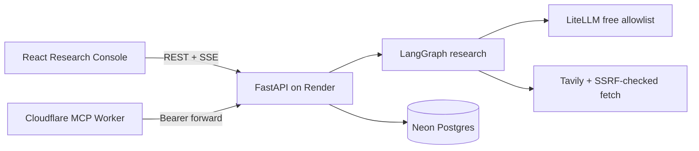

<a id="top"></a>

<div align="center">

# ResearchMind

### From a research question to an evidence-linked draft.

A multi-agent research system that searches the public web, stores evidence,
runs a bounded LangGraph workflow, and streams progress to a React console.

[](https://www.python.org/)
[](https://fastapi.tiangolo.com/)
[](https://www.langchain.com/langgraph)
[](https://react.dev/)
[](https://neon.tech/)
[](https://github.com/sumitjadhav1703/Multi_agent_research_system/actions/workflows/tests.yml)
[](LICENSE)

[**Open the Research Console →**](https://researchmind-console.vercel.app/)
&nbsp; · &nbsp; [API health](https://researchmind-api-sg.onrender.com/api/v1/health/ready)
&nbsp; · &nbsp; [MCP Worker](https://researchmind-mcp.jadhavsumit534.workers.dev/)
&nbsp; · &nbsp; [Report an issue](https://github.com/sumitjadhav1703/Multi_agent_research_system/issues)

</div>

---

## What it is

ResearchMind 2.0 is a deployable student / demo research stack:

- **FastAPI** API with durable jobs, guest quotas, and SSE progress
- **LangGraph** research graph with evidence, claims, and human review
- **LiteLLM SDK Router** free-provider allowlist (no paid fallback)
- **Neon PostgreSQL** for jobs, events, quotas, evidence, and checkpoints
- **React + Vite** Research Console
- **Cloudflare Worker** thin MCP forwarder to the API

The legacy Streamlit V1 pipeline remains in the repo as a frozen baseline (`v1-baseline`) so regressions stay visible. New work targets the V2 API and console.

Reports and scores still need human review. Free-tier hosts (Render) can cold-start; guest runs require Turnstile; real LLM runs need provider keys with `USE_MOCK_PROVIDER=false`.

## Live stack (Singapore)

| Surface | URL |
| --- | --- |
| Research Console | https://researchmind-console.vercel.app |
| API | https://researchmind-api-sg.onrender.com |
| MCP Worker | https://researchmind-mcp.jadhavsumit534.workers.dev |
| Spec / status | [`docs/RESEARCHMIND_2_0_SOURCE_OF_TRUTH.md`](docs/RESEARCHMIND_2_0_SOURCE_OF_TRUTH.md), [`docs/IMPLEMENTATION_STATUS.md`](docs/IMPLEMENTATION_STATUS.md), [`docs/deployment-report.md`](docs/deployment-report.md) |

## Architecture



## Quick start (local)

```bash
# Backend (Python 3.13)
python -m venv .venv && source .venv/bin/activate
pip install -r backend/requirements.txt
cp .env.example .env   # fill keys locally; never commit .env
export PYTHONPATH=. USE_MOCK_PROVIDER=true QUEUE_CONSUMER_ENABLED=false
uvicorn backend.app.main:app --reload --port 8000

# Console
cd frontend && npm ci && npm run dev
```

See [`.env.example`](.env.example) for required names. Secrets stay server-side only.

## Testing

```bash
# V2 backend
USE_MOCK_PROVIDER=true DATABASE_URL= QUEUE_CONSUMER_ENABLED=false TURNSTILE_SECRET_KEY= \
  PYTHONPATH=. python -m unittest discover -s backend/tests

# Frontend
cd frontend && npm test

# MCP worker
cd mcp-server && npm test
```

## Project layout

```text
backend/          FastAPI, LangGraph, jobs, quotas, providers
frontend/         React + Vite Research Console
mcp-server/       Cloudflare Worker MCP forwarder
docs/             Source of truth, ADRs, deployment report, status
evals/            Offline evaluation harness
infra/            Docker entrypoint
```

## Security and limits (honest)

- One guest research run per issued identity; global active/daily caps in Postgres
- Free-model allowlist only; `ALLOW_PAID_MODELS=true` fails closed
- Turnstile required for guest issuance when secret is configured
- SSRF checks are V1-level (DNS/scheme); not claimed closed without egress proxy
- Render Free may sleep; cold start can take about a minute

## License

MIT. See [LICENSE](LICENSE).
