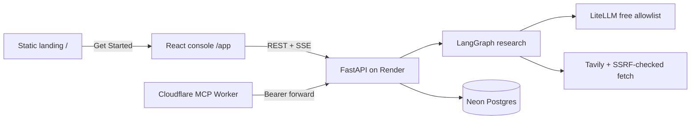

<a id="top"></a>

<div align="center">

# ResearchMind

**From a public research question to an evidence-linked draft.**

A multi-agent research demo that plans, searches the public web, stores evidence,
runs a bounded LangGraph workflow, and streams progress to a React console —
with durable Postgres jobs, guest quotas, and a thin MCP Worker.

[](https://github.com/sumitjadhav1703/Multi_agent_research_system/actions/workflows/tests.yml)
[](https://www.python.org/)
[](https://fastapi.tiangolo.com/)
[](https://www.langchain.com/langgraph)
[](https://react.dev/)
[](https://neon.tech/)
[](LICENSE)
[](#current-status)

[**Live site**](https://researchmind-console.vercel.app/)
· [API health](https://researchmind-api-sg.onrender.com/api/v1/health/ready)
· [MCP Worker](https://researchmind-mcp.jadhavsumit534.workers.dev/)
· [Spec](docs/RESEARCHMIND_2_0_SOURCE_OF_TRUTH.md)
· [Status](docs/IMPLEMENTATION_STATUS.md)
· [Issues](https://github.com/sumitjadhav1703/Multi_agent_research_system/issues)

</div>

---

## Table of contents

- [Current status](#current-status)
- [Resume after clone](#resume-after-clone)
- [What it does](#what-it-does)
- [Live stack](#live-stack)
- [Architecture](#architecture)
- [Repository layout](#repository-layout)
- [Prerequisites](#prerequisites)
- [Quick start (local)](#quick-start-local)
- [Environment variables](#environment-variables)
- [Testing](#testing)
- [Evaluation](#evaluation)
- [Public demo walkthrough](#public-demo-walkthrough)
- [Deployment](#deployment)
- [Security and known limits](#security-and-known-limits)
- [Docs map](#docs-map)
- [Contributing](#contributing)
- [License](#license)

---

## Current status

ResearchMind 2.0 is a **portfolio / student demo** with a public Singapore stack.

| Claim | Reality |
| --- | --- |
| Public console | Live on Vercel (`sin1`) — landing at `/`, Research Console at `/app` |
| Public API | Live on Render Free (`singapore`) |
| Database | Neon Postgres (`aws-ap-southeast-1`) |
| MCP | Thin Cloudflare Worker forwarding to the API |
| Guest research | Needs Cloudflare Turnstile keys on console + API |
| Real LLM runs | Need provider keys on Render and `USE_MOCK_PROVIDER=false` |
| Cold starts | Render Free can sleep after idle; wake can take about a minute. A Cloudflare Worker cron (`*/10`) pings `/health/live` to reduce this; not an SLA |
| “Production-ready” | **Not claimed.** Measured behavior and known limits are documented honestly |
| Offline evaluation | Fixture DeepEval + deterministic checks **published** (not a V1 vs V2 table) |
| Estimated cost | List-price token×rate (+ search call rate) when measured; **unknown** when not — never fake `$0` |

Authoritative product/architecture text: [`docs/RESEARCHMIND_2_0_SOURCE_OF_TRUTH.md`](docs/RESEARCHMIND_2_0_SOURCE_OF_TRUTH.md).  
Live execution board: [`docs/IMPLEMENTATION_STATUS.md`](docs/IMPLEMENTATION_STATUS.md).  
Measured hosts: [`docs/deployment-report.md`](docs/deployment-report.md).  
Eval write-up: [`docs/evals/RESULTS.md`](docs/evals/RESULTS.md).

---

## Resume after clone

GitHub `main` is the source of truth for code and docs. A wiped laptop recovers the repo with:

```bash
git clone https://github.com/sumitjadhav1703/Multi_agent_research_system.git
cd Multi_agent_research_system
```

**Secrets are not in git.** Local `.env` is gitignored. After clone, recreate keys from cloud dashboards / a password manager (never from a committed file):

| Secret | Where it lives |
| --- | --- |
| `DATABASE_URL` | Neon + Render env |
| Provider keys (`GROQ_*`, `GEMINI_*`, `MISTRAL_*`, `OPENROUTER_*`, `TAVILY_*`, optional `META_API_KEY`) | Render env |
| `TURNSTILE_SECRET_KEY` | Render env |
| `VITE_TURNSTILE_SITE_KEY`, `VITE_API_BASE` | Vercel env |
| Cloudflare Worker / Actions (`CLOUDFLARE_*`, Worker secrets) | Cloudflare + GitHub Actions secrets |

Then follow [Quick start (local)](#quick-start-local) for a mock offline run, or point at the live Singapore stack above.

---

## What it does

| Capability | Detail |
| --- | --- |
| Portfolio landing | Static HTML/CSS/JS full-bleed video hero at `/` (no Sign-in page) |
| Research Console | React app at `/app` — ask one public question, watch SSE progress, open report + evidence |
| Bounded research graph | LangGraph planners / workers / verifier / writer with evidence and claims |
| Free-only providers | LiteLLM SDK Router allowlist for role models; fail closed if `ALLOW_PAID_MODELS=true`; optional Meta Muse Spark Contributor last-resort after free hops fail |
| Durable jobs | PostgreSQL jobs, events, quotas, evidence, graph checkpoints (not in-memory queues) |
| Guest quotas | One-use guest identity + global active/daily caps enforced in the backend |
| Progress transport | REST for commands, SSE for replayable progress (no first-release WebSockets) |
| MCP surface | Authenticated Cloudflare Worker that forwards to FastAPI; does not re-implement the graph |
| V1 baseline | Frozen Streamlit pipeline tagged `v1-baseline` kept for regression visibility |

**Who it is for:** recruiters, reviewers, and engineers evaluating a multi-agent research architecture demo.  
**Who it is not for:** production research workloads, private/sensitive data, or unlimited public LLM usage.

---

## Live stack

| Surface | Region | URL |
| --- | --- | --- |
| Marketing landing + console | Vercel `sin1` | https://researchmind-console.vercel.app (`/` landing, `/app` console) |
| API | Render `singapore` | https://researchmind-api-sg.onrender.com |
| MCP Worker | Cloudflare Workers | https://researchmind-mcp.jadhavsumit534.workers.dev |
| Postgres | Neon `aws-ap-southeast-1` | Wired as Render `DATABASE_URL` (secret; not in git) |

Quick checks (`/health/ready` returns only `status`, `database`, `use_mock_provider`):

```bash
curl -fsS https://researchmind-api-sg.onrender.com/api/v1/health/live
curl -fsS https://researchmind-api-sg.onrender.com/api/v1/health/ready
```

---

## Architecture



Design constraints enforced in code and docs:

- PostgreSQL is the durable source of truth for jobs, events, idempotency, quotas, evidence, and checkpoints
- LiteLLM Router inside FastAPI first; free-only allowlist for role models; optional Meta Muse Spark Contributor last-resort after free hops exhaust
- Secrets stay server-side (never in the frontend bundle or logs)
- First Render deploy profile: one web service, one Uvicorn worker, one bounded queue consumer

---

## Repository layout

```text
backend/                 FastAPI app, LangGraph, jobs, quotas, providers, tests
frontend/
  landing/               Static portfolio landing (index.html, styles.css, main.js)
  src/                   React Research Console
  scripts/copy-landing.mjs
  public/                Shared logo + display font for /app
mcp-server/              Cloudflare Worker MCP forwarder
docs/                    Spec, ADRs, status, deployment report, engineering story
evals/                   Offline evaluation fixtures / harness
infra/                   Docker entrypoint helpers
scripts/                 run_offline_suites.sh (offline mock-provider test matrix)
.github/workflows/       tests.yml, deploy-mcp-worker.yml, keep-api-awake.yml (manual only)
render.yaml              Render blueprint (API web service researchmind-api-sg)
vercel.json              Vercel build: landing at / , SPA under /app
Dockerfile               API image (Python 3.13)
.env.example             Backend env names (no secrets)
```

V1 Streamlit code lives in [`v1/`](v1/) (frozen baseline, tag `v1-baseline`; run with `streamlit run v1/app.py`; not deployed). Prefer the V2 paths above for new work.

---

## Prerequisites

| Tool | Version / note |
| --- | --- |
| Python | **3.13** (3.15 has failed LiteLLM native builds in this environment) |
| Node.js | 20+ recommended (Vercel project may use a newer Node) |
| npm | Comes with Node; used for `frontend/` and `mcp-server/` |
| Postgres | Optional locally; Neon URL required for durable hosted jobs |
| Docker | Optional; used for the Render API image |

---

## Quick start (local)

### 1. Clone and env

```bash
git clone https://github.com/sumitjadhav1703/Multi_agent_research_system.git
cd Multi_agent_research_system

cp .env.example .env
# Edit .env locally. Never commit .env or real keys.
```

For a fast offline API boot, set at least:

```bash
USE_MOCK_PROVIDER=true
QUEUE_CONSUMER_ENABLED=false
DATABASE_URL=
TURNSTILE_SECRET_KEY=
```

### 2. Backend API

```bash
python3.13 -m venv .venv
source .venv/bin/activate   # Windows: .venv\Scripts\activate
pip install -r backend/requirements.txt

export PYTHONPATH=.
uvicorn backend.app.main:app --reload --host 127.0.0.1 --port 8000
```

Health:

```bash
curl -fsS http://127.0.0.1:8000/api/v1/health/live
```

### 3. Frontend (landing + console)

```bash
cd frontend
cp .env.example .env
# Leave VITE_API_BASE empty to use the Vite /api proxy → 127.0.0.1:8000
npm ci
npm run dev
```

- Dev landing: `http://127.0.0.1:5173/`
- Dev console: `http://127.0.0.1:5173/app/`

Production-like local build:

```bash
cd frontend
npm run build
npx serve dist -l 4173
# / = landing, /app = console
```

### 4. Optional: MCP Worker (local)

```bash
cd mcp-server
npm ci
npm test
# RESEARCHMIND_API_BASE is set in mcp-server/wrangler.jsonc (Singapore API origin).
# Use .dev.vars (see .dev.vars.example) to point `npm run dev` at a local API.
```

---

## Environment variables

### Backend (server-side only)

| Variable | Purpose |
| --- | --- |
| `DATABASE_URL` | Neon/Postgres connection string (durable jobs) |
| `USE_MOCK_PROVIDER` | `true` for offline/CI; `false` for live free providers |
| `ALLOW_PAID_MODELS` | Must stay `false` (startup fails closed if true) |
| `FREE_MODEL_ALLOWLIST` | Comma-separated LiteLLM free model ids |
| `GROQ_API_KEY` / `GEMINI_API_KEY` / `MISTRAL_API_KEY` / … | Provider keys when not mocking |
| `TAVILY_API_KEY` | Web search |
| `TURNSTILE_SECRET_KEY` | Cloudflare Turnstile verify (guest issuance) |
| `CORS_ORIGINS` | Exact console origins, comma-separated, no `*`, no paths |
| `QUEUE_CONSUMER_ENABLED` | Run the in-process queue consumer |
| `GLOBAL_MAX_ACTIVE_RUNS` / `GLOBAL_DAILY_RUN_CAP` | Demo load caps |
| `MAX_MODEL_CALLS_PER_RUN` / `MAX_RUN_WALL_CLOCK_SECONDS` | Per-run budgets |

Full annotated list: [`.env.example`](.env.example).

### Frontend (public)

| Variable | Purpose |
| --- | --- |
| `VITE_API_BASE` | Public API origin with no trailing path (empty = same-origin / Vite proxy) |
| `VITE_TURNSTILE_SITE_KEY` | Public Turnstile site key (empty shows a paste field) |

See [`frontend/.env.example`](frontend/.env.example). Never put `TURNSTILE_SECRET_KEY`, provider keys, or `DATABASE_URL` in Vite env.

---

## Testing

```bash
# V2 backend (Python 3.13)
USE_MOCK_PROVIDER=true DATABASE_URL= QUEUE_CONSUMER_ENABLED=false TURNSTILE_SECRET_KEY= \
  PYTHONPATH=. python -m unittest discover -s backend/tests

# V1 baseline (frozen Streamlit path)
cd v1 && python -m unittest discover -s tests

# Frontend
cd frontend && npm test && npm run build

# MCP worker
cd mcp-server && npm test
```

CI workflow: [`.github/workflows/tests.yml`](.github/workflows/tests.yml) (jobs: `v1`, `backend` + `pip check`, `evals`, `mcp`, `docker`, `frontend`). Offline counts at 2026-11-10: V1 16, backend 221, evals 15, frontend 47, MCP 31.

---

## Evaluation

Offline harness results (2026-11-09). These score **hand-built fixture artifacts**, not live V1/V2 research runs.

| Check | Result |
| --- | --- |
| Deterministic fixture self-check | **20/20** matched (`golden-v0.1`, 32 cases in the set) |
| DeepEval judge | `meta/muse-spark-1.3-contributor` (Meta Model API) |
| Faithfulness mean | **0.925** (n=20) |
| Answer relevancy mean | **0.700** (n=20) |
| Contextual precision mean | **0.833** (n=18) |
| Contextual recall mean | **0.667** (n=18) |
| Numeric scores / errors | **80** scored · **0** errors |
| Trace metrics | Skipped (public graph is not DeepEval-traced) |
| V1 vs V2 comparison | **Not measured** |

Published JSON (API + console Evaluation page): [`docs/evals/published-summary.json`](docs/evals/published-summary.json).  
Narrative + history: [`docs/evals/RESULTS.md`](docs/evals/RESULTS.md).

```bash
PYTHONPATH=. python -m evals.cli deterministic
RM_EVAL_JUDGE=1 PYTHONPATH=. python -m evals.cli judge --confirm-offline
```

---

## Public demo walkthrough

1. Open https://researchmind-console.vercel.app/ — portfolio landing (video hero).
2. Click **Get Started** → `/app`.
3. Complete Turnstile (requires keys on Vercel + Render). Without keys, the gate shows a paste field and cannot complete a normal guest flow.
4. Ask one **public, non-sensitive** question. Expect HTTP `202`, then SSE progress.
5. Open **Report** and **Evidence** for the same run. Refresh should replay saved events.
6. A second start with the same guest should hit the one-use quota.

If the API banner says the service is sleeping, wait for Render Free wake (~1 minute), then retry.

---

## Deployment

### Frontend (Vercel)

Configured by root [`vercel.json`](vercel.json):

- Install: `npm ci --prefix frontend`
- Build: `npm run build --prefix frontend` (Vite builds `/app`, then copies `frontend/landing` to dist root)
- Output: `frontend/dist`
- Rewrites: `/app` and `/app/*` → SPA `index.html`; `/` serves the static landing

Set on Vercel:

- `VITE_API_BASE=https://researchmind-api-sg.onrender.com`
- `VITE_TURNSTILE_SITE_KEY=<public site key>`

Push to `main` triggers production deploy when the Git integration is connected.

### API (Render)

- Blueprint: [`render.yaml`](render.yaml) — Docker web service `researchmind-api-sg`, `WEB_CONCURRENCY=1`, Singapore region, `autoDeployTrigger: commit` on `main`
- Image: [`Dockerfile`](Dockerfile) + [`infra/docker-entrypoint.sh`](infra/docker-entrypoint.sh)
- Required dashboard secrets: `DATABASE_URL`, provider keys, `TURNSTILE_SECRET_KEY`, `CORS_ORIGINS` (exact Vercel origin)

### MCP Worker (Cloudflare)

Pushes to `main` that touch `mcp-server/**` deploy via [`.github/workflows/deploy-mcp-worker.yml`](.github/workflows/deploy-mcp-worker.yml) (needs GitHub secrets `CLOUDFLARE_API_TOKEN` and `CLOUDFLARE_ACCOUNT_ID`). Manual deploy:

```bash
cd mcp-server
npx wrangler deploy
```

`RESEARCHMIND_API_BASE` is set in [`mcp-server/wrangler.jsonc`](mcp-server/wrangler.jsonc). The Worker also has a `*/10` cron that pings the API's `/api/v1/health/live`.

Deeper checklist: [`docs/deployment-report.md`](docs/deployment-report.md).

---

## Security and known limits

| Topic | Honest position |
| --- | --- |
| Quotas | One guest research run per issued identity; global caps in Postgres |
| Providers | Free-model allowlist for role primary/fallback; paid markers / `ALLOW_PAID_MODELS=true` fail closed; optional Meta Muse Spark Contributor last-resort only when `META_LAST_RESORT_ENABLED=true`, `META_API_KEY` is set, and the model is allowlisted |
| Secrets | Server-side only; not logged or shipped in the frontend bundle |
| Turnstile | Required for normal guest issuance when secret + site key are configured |
| SSRF | In-process checked IP dial (`backend/app/research/fetch.py` with an overall read deadline, `egress_fetch.py`); residual DNS-rebinding / connect-time risk — **not** claimed closed without an egress proxy |
| Hosting | Render Free idle sleep; cold start not a measured SLA |
| Data | Demo for public topics only — do not submit private or sensitive content |
| Eval | Offline fixture DeepEval + deterministic results published on README / Evaluation / Evidence empty state; not part of every public request |

---

## Docs map

| Doc | Use when |
| --- | --- |
| [`docs/RESEARCHMIND_2_0_SOURCE_OF_TRUTH.md`](docs/RESEARCHMIND_2_0_SOURCE_OF_TRUTH.md) | Product + architecture authority |
| [`docs/IMPLEMENTATION_STATUS.md`](docs/IMPLEMENTATION_STATUS.md) | Milestone board and test evidence |
| [`docs/deployment-report.md`](docs/deployment-report.md) | Hosts, regions, deploy checklist |
| [`docs/engineering-story/`](docs/engineering-story/) | Portfolio narrative: bottlenecks, decisions, eval, deploy |
| [`docs/ADR/`](docs/ADR/) | Architecture decision records |
| [`AGENTS.md`](AGENTS.md) | Learned preferences for coding agents |

---

## Contributing

1. Prefer Python **3.13** for backend work.
2. Keep V1 modules and offline V1 tests green while extending V2 under `backend/` / `frontend/`.
3. Do not commit `.env`, credentials, or secret values.
4. Run the relevant test suite before opening a PR.
5. Update `docs/IMPLEMENTATION_STATUS.md` when milestone behavior changes — with real command output, not invented pass claims.

Issues: https://github.com/sumitjadhav1703/Multi_agent_research_system/issues

---

## License

**MIT** — see [LICENSE](LICENSE).

---

<div align="center">

[Back to top](#top)

</div>
