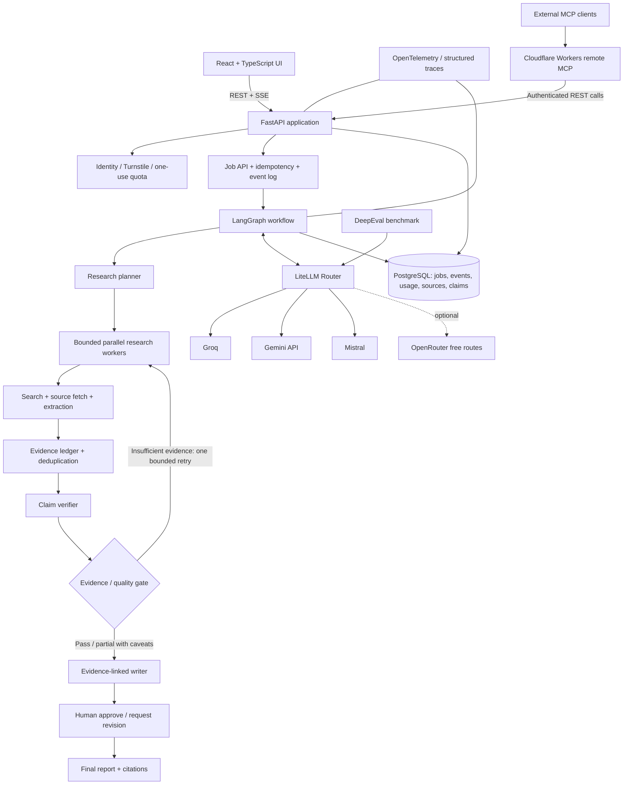
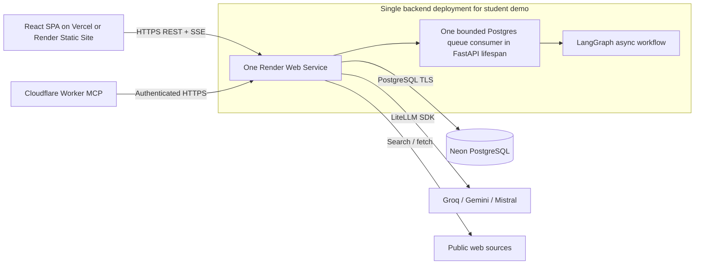
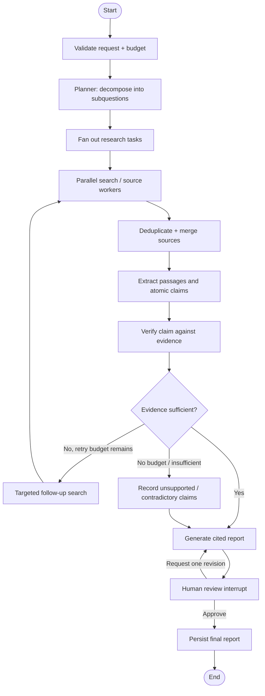

# ResearchMind 2.0 — Implementation Blueprint

**Project:** [sumitjadhav1703/Multi_agent_research_system](https://github.com/sumitjadhav1703/Multi_agent_research_system)  
**Prepared:** 7 November 2026  
**Target:** Production-style engineering demonstrated through a deployable, low-cost student portfolio application  
**Core stack:** React + TypeScript, FastAPI, LangGraph, LiteLLM SDK Router, DeepEval, Neon PostgreSQL, Render backend, remote MCP on Cloudflare Workers

---

## 0. Executive recommendation

Rebuild the application layer around the existing research pipeline. Do **not** throw away the current repository or immediately add many agents. Preserve the current four-stage implementation as **ResearchMind 1.0**, measure it, and build ResearchMind 2.0 beside it or behind a feature flag.

The new project should demonstrate five things:

1. **Research quality:** multiple research questions, multiple independent sources, claim-level evidence, explicit contradictions and source-linked reports.
2. **Agent engineering:** a real LangGraph state machine with bounded parallel workers, controlled loops, durable checkpoints and human approval.
3. **Provider resilience:** LiteLLM routes model calls across a small allowlist of free-tier providers, with health-aware fallback and no silent paid fallback.
4. **Measurable quality:** DeepEval benchmark results plus deterministic citation and safety checks.
5. **Product engineering:** a React interface, resumable live progress, one-use demo quotas, persistent jobs, observability and a remote MCP server.

The project should be described as a **student demonstration / portfolio system**, not a production service. Design for deployment from the first milestone: one portable Docker backend, one static frontend, a managed Postgres database, and a thin MCP edge service. Production-style controls are useful evidence of engineering judgement, but free inference quotas, free hosting, limited concurrency and single-instance execution are not production-grade service guarantees. The default demo must have a public URL and recover from a backend restart without relying on local files or in-memory jobs.

### Recommended build order

1. Freeze and benchmark the current implementation.
2. Add LiteLLM and provider capability tests.
3. Rebuild orchestration as a bounded LangGraph workflow.
4. Add multi-source evidence extraction and claim verification.
5. Add PostgreSQL persistence, quotas and durable job recovery.
6. Build the React frontend and SSE progress stream.
7. Add DeepEval and observability.
8. Publish a protected remote MCP server.
9. Deploy, document, benchmark and record the final demo.

---

## 1. What exists today and what must change

The current README and source files establish a useful base:

- Streamlit UI and CLI share a resumable Python pipeline.
- The stages are Search, Read, Write and Critic.
- Search uses Tavily; source extraction uses Requests and BeautifulSoup.
- Groq serves `openai/gpt-oss-20b` for all four stages.
- The reader is instructed to select one relevant HTML source.
- The critic is explicitly described as a review pass, not independent fact checking.
- Successful stages are saved in in-memory state and can be resumed after some provider failures.
- The project already has mocked tests, GitHub Actions, input bounds and public-URL validation.
- The README documents the limitations of in-memory session state, one-source reading, PDF support, shared quotas, authentication and connection-time SSRF isolation.

### Gaps to solve

| Area | Current limitation | Target change |
|---|---|---|
| Orchestration | Sequential Python stage loop around agent calls | Explicit LangGraph `StateGraph` with conditional edges, fan-out and checkpoints |
| Research depth | One source selected by the reader | Planner-generated subquestions and bounded multi-source retrieval |
| Evidence | Search snippets and one source summary | Structured source records, passages, atomic claims and claim-to-source links |
| Verification | Same-model prompt critique | Evidence-grounded claim verification plus deterministic citation checks |
| Models | One model/provider for every stage | LiteLLM aliases with role-specific models and controlled fallbacks |
| Evaluation | Offline pipeline/security tests only | DeepEval golden dataset, component metrics and end-to-end trace metrics |
| Persistence | Browser-session/in-memory state | PostgreSQL jobs, events, usage ledger and persistent LangGraph checkpoints |
| Frontend | Streamlit | React + TypeScript single-page research workspace |
| Streaming | Stage-level UI progress | LangGraph events streamed through FastAPI SSE and replayable job events |
| Cost protection | Provider-level limits only | One-run identity quota, global cap, per-run budgets and atomic idempotency |
| MCP | No external tool interface | Authenticated remote ResearchMind MCP endpoint |
| Operations | Safe errors and basic logs | Structured logs, trace IDs, usage accounting, health checks and recovery tests |

**Important:** a second LLM critic is not independent ground truth. The verifier must compare a claim to actual retrieved passages. The system must show the source passage and verification reason so a human can challenge the result.

---

## 2. Target architecture



### Separation of responsibilities

- **React:** presentation, input validation, live event display, human review and report inspection. It must never hold provider API keys.
- **FastAPI:** authentication, quotas, idempotency, job lifecycle, event streaming, result APIs and MCP-facing backend endpoints.
- **LangGraph:** state transitions, parallel research, verification loops, human interruption and checkpoint recovery.
- **LiteLLM:** provider abstraction, model aliases, fallback decisions and usage-normalized responses.
- **PostgreSQL:** durable job state, graph checkpoints, evidence, event replay and usage ledger.
- **DeepEval:** offline/controlled quality evaluations. It is not part of the public request path.
- **Cloudflare Worker MCP:** thin external interface that authenticates MCP clients and forwards allowed tool requests to the FastAPI API.

Keep the graph and backend in one Python service for the student demo. Avoid splitting every agent into a microservice.

### Deployment topology (build this shape from the beginning)



- The public backend is a **Render Web Service**, not a Render Background Worker in the first release. The same single process serves FastAPI and starts one bounded queue-consumer coroutine during the application lifespan.
- The queue is persisted in PostgreSQL. Do not use FastAPI `BackgroundTasks` as the durable job system; a process restart would lose the in-memory task.
- The queue consumer leases a job row using a short transaction and `FOR UPDATE SKIP LOCKED`, writes a lease expiry/heartbeat, executes the graph, and persists each checkpoint/event before moving on.
- Run exactly one Render instance and one Uvicorn worker initially (`WEB_CONCURRENCY=1`). Set graph fan-out to at most two asynchronous research workers and allow only one research run globally at a time on the public free demo.
- This is a deliberately single-instance architecture, not horizontal scaling. The queue/checkpointer design makes a later move to a separate worker service possible without changing the frontend API.
- The React app is static. Do not deploy long-running research work inside Vercel Functions. The browser talks directly to FastAPI over HTTPS; configure exact CORS origins.
- Use Neon rather than Render Free Postgres. Keep job, checkpoint, event and quota state in the database, never in the container filesystem.


---

## 3. Provider plan and LiteLLM gateway

### 3.1 Recommended provider roster

Use three core provider accounts first. Add an aggregator only as a reserve after testing. Free tiers are quotas for prototyping, not service-level guarantees; quotas vary by model, account, region and time and can change.

| Role | Provider to test first | Backup | Notes / risks |
|---|---|---|---|
| General research / writing | Groq (existing account and integration) | Gemini API | Groq limits are organization-level and depend on model/account. Read `Retry-After` and quota headers. |
| Planner / summarization | Groq or Gemini Flash-class model | Mistral Free mode | Use a smaller model for short planning steps; do not use the strongest available model for every node. |
| Tool-calling research worker | Groq model that passes tool-call tests | Gemini model that passes the same tests | Do not assume a provider supports the same tool schema or JSON mode. Run compatibility tests. |
| Claim verifier | Different provider from the writer where possible | Mistral / Gemini | Use a separate model to reduce same-model confirmation bias; it is still an LLM judge, not ground truth. |
| Evaluation judge | Fixed LiteLLMModel provider/model | A separately tested provider | Pin evaluator model and version for all comparable runs. DeepEval judge calls consume quotas too. |
| Optional reserve | OpenRouter `:free` model route | Cloudflare Workers AI model | Free models and availability change. OpenRouter free routes are quota-limited and failed calls count against its daily cap. |

#### Provider findings verified on 7 November 2026

**Groq**

- Retain it because the current project already uses Groq and its API is OpenAI-compatible.
- Limits include RPM, RPD, TPM, TPD and sometimes separate input/output limits; they apply at the organization level.
- Read returned rate-limit and `Retry-After` headers. Exact quotas should be checked in the account dashboard before a demo.
- Official docs: [Groq rate limits](https://console.groq.com/docs/rate-limits).

**Google Gemini API**

- A free tier exists for selected models, but limits are project/model-specific and can be more restrictive for preview/experimental models.
- Critical privacy trade-off: Google states that content submitted under unpaid Gemini services may be used to improve products and may be read or processed by human reviewers. Do not send sensitive, confidential, personal or private data through unpaid Gemini endpoints.
- Use it for public research questions only, with a clear notice in the app.
- Official docs: [Gemini rate limits](https://ai.google.dev/gemini-api/docs/rate-limits), [pricing](https://ai.google.dev/gemini-api/docs/pricing), [additional terms](https://ai.google.dev/gemini-api/terms).

**Mistral API**

- Free mode is intended for evaluation and prototyping and has the lowest limits.
- Limits include requests per second, tokens per minute and tokens per month; inspect the live account limits rather than hard-coding a quota.
- Official source: [Mistral API rate limits](https://help.mistral.ai/en/articles/698531-why-am-i-hitting-api-rate-limits-and-how-do-i-increase-them).

**OpenRouter free models (optional reserve)**

- Current documentation lists 20 requests/minute and 50 requests/day for `:free` model variants; failed attempts count toward the daily cap.
- It is an aggregator, not an independent guaranteed source of capacity. Provider/model availability can change.
- Do not make it the only fallback and do not add paid routing/top-ups for this student demo.
- Official source: [OpenRouter free models](https://openrouter.ai/collections/free-models).

**Cloudflare Workers AI (optional)**

- Cloudflare documents a free allocation of 10,000 Neurons/day for Workers AI, shared across its model catalogue; model costs differ by neuron use.
- Consider it only after verifying the selected model's tool-calling and structured-output behavior through LiteLLM.
- This is separate from the Cloudflare Workers request allowance used to host the MCP endpoint.
- Official source: [Workers AI pricing](https://developers.cloudflare.com/workers-ai/platform/pricing/).

### 3.2 Do not hard-code model IDs throughout the code

Create one configuration file and environment variables. Model IDs change and providers retire endpoints.

Example configuration intent (model IDs are illustrative; choose currently enabled IDs after testing):

```yaml
model_groups:
  planner:
    primary: ${PLANNER_PRIMARY_MODEL}
    fallbacks: [${PLANNER_FALLBACK_MODEL}]
  researcher:
    primary: ${RESEARCH_PRIMARY_MODEL}
    fallbacks: [${RESEARCH_FALLBACK_MODEL}]
  verifier:
    primary: ${VERIFIER_PRIMARY_MODEL}
    fallbacks: [${VERIFIER_FALLBACK_MODEL}]
  writer:
    primary: ${WRITER_PRIMARY_MODEL}
    fallbacks: [${WRITER_FALLBACK_MODEL}]
```

The real LiteLLM config must use the actual provider prefixes and provider model names supported by the installed LiteLLM release. Keep secret keys in environment variables only.

### 3.3 LiteLLM implementation choice

**Phase 1 recommendation: use the LiteLLM Python SDK `Router` inside the FastAPI backend.** This centralizes model access without adding another network service that can sleep or fail. Keep application-level quota enforcement in PostgreSQL.

**Later option: run the LiteLLM Proxy as a separate gateway** if you need external clients, multiple application services, virtual keys, team policies or centralized spend reporting.

Why not start with the standalone Proxy? LiteLLM documents that virtual-key budgets and spend budgets require PostgreSQL. A DB-less Proxy deployment can fail open for budget checks rather than enforcing a hard budget. The project already needs PostgreSQL, but the Proxy still adds another deployable service, secrets, network boundary and operational workload. Start with the SDK router and add Proxy only when the project actually needs it.

Official docs:

- [LiteLLM SDK and Proxy overview](https://docs.litellm.ai/docs/)
- [Providers supported](https://docs.litellm.ai/docs/providers/)
- [Retries, fallbacks and cooldowns](https://docs.litellm.ai/docs/router/learn/reliability)
- [Budgets and rate limits](https://docs.litellm.ai/docs/proxy/users)

### 3.4 Fallback rules

Use a small, explicit fallback chain per model group.

| Failure | Action |
|---|---|
| HTTP 429 / quota exceeded | Respect `Retry-After`; cool down deployment; try one allowed free fallback if the job budget permits |
| 5xx / temporary outage | One bounded fallback attempt |
| Timeout / network error | One bounded retry or a different provider |
| Invalid request / unsupported parameter | Do not repeat the same call; validate or route to a tested compatible deployment |
| 401 / 403 / invalid key | Mark provider unhealthy and stop using it; do not retry repeatedly |
| Model not found / retired | Mark deployment unavailable and use configured fallback; create an operational warning |
| Tool-call / JSON-schema mismatch | Use a separately tested compatible model group or fail the stage safely; do not assume a fallback is equivalent |

Rules:

- LiteLLM must own the retry loop; set underlying SDK retries to zero to avoid retry multiplication.
- Start with at most one fallback hop per stage and no more than two attempts total for a model operation.
- Use a strict **free-model allowlist**. Never route to a paid model automatically.
- Do not treat provider failover as cost control. A fallback still consumes another provider's quota.
- Record provider, model, attempt, status, latency and token usage for every model call.
- Add a small health/capability test for tool calling, JSON/Pydantic output and streaming before enabling a model for a role.
- Keep model IDs, maximum tokens and supported features in config, not scattered through graph code.

### 3.5 Cost-aware model allocation

- Planner: smallest acceptable model.
- Research workers: a model that passes tool-calling tests; avoid expensive long-context calls.
- Extraction and normalization: deterministic Python where possible; LLM only when needed.
- Claim verification: a different provider/model from the writer if quotas permit.
- Writer: one report synthesis call after evidence is assembled.
- Quality checks: deterministic checks first, DeepEval only in controlled evaluation runs.

Do not use an LLM for URL normalization, exact duplicate detection, schema validation, citation-ID existence or simple arithmetic.

---

## 4. ResearchMind MCP server

### 4.1 What MCP does here

MCP is an interoperability layer for exposing tools to external AI clients. It is **not** a backup model provider and does not increase LLM inference quota. LiteLLM routes model calls; MCP exposes selected actions and data.

Build a custom **ResearchMind MCP Server** so an MCP-compatible client can inspect or start a ResearchMind workflow under the same authentication, quota and safety rules as the web app.

### 4.2 Recommended free hosting: Cloudflare Workers

Cloudflare's current Workers Free plan documents 100,000 requests/day, 10 ms CPU time per request and 128 MB memory. Its remote MCP guide supports Streamable HTTP, a `workers.dev` endpoint and optional OAuth authentication/authorization. A stateless `createMcpHandler` is suitable for a thin tool façade; long-lived state should remain in a database or the backend.

Use Cloudflare Worker for:

- MCP protocol handling.
- OAuth / token validation.
- Input validation and forwarding to the FastAPI backend.
- A small number of metadata/status tools.

Do **not** run full HTML/PDF extraction, embeddings, long LLM workflows or heavy parsing inside the Worker. Keep that compute in the Python backend or provider APIs.

References:

- [Cloudflare remote MCP server guide](https://developers.cloudflare.com/agents/model-context-protocol/guides/remote-mcp-server/)
- [Workers Free plan limits](https://developers.cloudflare.com/workers/platform/limits/)
- [Workers AI free allocation](https://developers.cloudflare.com/workers-ai/platform/pricing/)
- [MCP Streamable HTTP transport specification](https://modelcontextprotocol.io/specification/2025-06-18/basic/transports)

### 4.3 MCP tool surface

Expose a deliberately small tool set:

| Tool | Purpose | Access |
|---|---|---|
| `create_research_run` | Start a bounded research job | Authenticated; consumes the one-use quota; explicit user request only |
| `get_research_run` | Get status and current stage | Authenticated; owner-scoped |
| `get_research_report` | Retrieve final report and citation metadata | Authenticated; owner-scoped |
| `list_research_sources` | List the sources used in a report | Authenticated; owner-scoped |
| `get_claim_evidence` | Retrieve evidence passages for a claim | Authenticated; owner-scoped |
| `get_evaluation_summary` | Read a published evaluation summary | Read-only; public only if manually published |

Do not expose:

- Arbitrary shell/command execution.
- Arbitrary database queries.
- Unrestricted URL fetching.
- Provider keys or environment variables.
- Admin quota reset tools.
- Unauthenticated research-start tools.

### 4.4 Authentication and safety

- Use Cloudflare's OAuth flow for remote MCP clients or a scoped bearer token for private developer use.
- Scope access by user/run ID. A client must not access another user's job by guessing a UUID.
- Treat `create_research_run` as a side-effecting, quota-consuming tool.
- Apply the exact same quota gate used by the browser API. MCP must not create a bypass around rate limits.
- Keep tool results bounded and return references to source records rather than huge raw documents.
- Add MCP Inspector checks for initialize, list tools, call tools, invalid inputs, missing authorization and quota exhaustion.

### 4.5 How the agent uses MCP

Keep internal graph nodes as normal typed Python services/functions for reliability and lower latency. Use the remote MCP server primarily for external clients. Add MCP-client access from the graph only when there is a real external MCP tool you need to consume. Do not route every internal function through an HTTP MCP round trip just to claim MCP usage.

---

## 5. LangGraph research workflow

### 5.1 Target graph



### 5.2 Graph state

Use typed state (TypedDict or Pydantic) with explicit fields:

- `run_id`, `owner_id`, `topic`, `created_at`, `config_version`
- `research_plan`: subquestions and expected evidence
- `worker_tasks`: task IDs, query, status and provider metadata
- `sources`: normalized source records and extraction status
- `claims`: atomic claim ID, text, evidence IDs, verification status and reason
- `contradictions`: conflicting sources or values
- `report_draft`, `review_feedback`, `approval_status`
- `usage`: model calls, tokens, elapsed time and estimated cost
- `warnings`, `errors`, `stop_reason`

Keep large page text and full documents in source storage, not repeatedly copied through every graph state snapshot. Store source IDs and concise passages in graph state.

### 5.3 Parallel research workforce

Use LangGraph's `Send` fan-out/map-reduce pattern to dispatch independent subquestions to separate worker nodes. The planner may create up to three subquestions for the first version. Run no more than two workers concurrently initially; raise this only after provider quota and latency tests.

Each worker should:

1. Receive one subquestion and a bounded query budget.
2. Search once (or use an explicitly allowed follow-up).
3. Fetch a small number of candidate pages.
4. Extract title, URL, domain, publication date if available, text hash and evidence passages.
5. Return structured output, source IDs and a clear failure/partial-success status.

An aggregator should deduplicate by canonical URL and normalized content hash, merge source metadata, and resolve partial failures. Do not let parallel workers mutate one shared object without a reducer; return isolated result objects and merge them in a dedicated node.

**Initial limits (configurable):**

- Up to 3 research subquestions.
- Up to 2 parallel workers.
- Up to 6 unique source pages per run.
- Up to 4 search calls per run, including one targeted follow-up.
- One verification-driven research retry.
- One report revision after human feedback.
- A strict maximum model-call and token budget per run.

These are initial safety bounds, not proven optimal values. Change them only after measuring quality, latency and provider usage.

### 5.4 Evidence ledger and claim-level verification

Add Pydantic models similar to:

```python
class EvidenceItem(BaseModel):
    evidence_id: str
    source_id: str
    quote: str
    page_or_section: str | None = None
    relevance_reason: str

class Claim(BaseModel):
    claim_id: str
    text: str
    evidence_ids: list[str]
    status: Literal["supported", "contradictory", "insufficient"]
    verification_reason: str
```

Rules:

- Every factual section should be derived from claim objects.
- A `supported` claim needs at least one evidence item that actually supports it.
- If sources conflict, preserve both sides and label the conflict; do not let the writer silently choose one.
- If evidence is missing, either omit the claim or explicitly mark the uncertainty.
- Keep exact source URL, title, domain, publication date (when available), retrieval time and text hash.
- Preserve concise quote spans so the UI can show exactly what supported a claim.
- Run deterministic citation checks: citation ID exists, citation URL matches source record, source was actually fetched or snippet-only status is explicit, quoted text exists in extracted passage, and there are no unused/invented IDs.

LLM verification remains fallible. Do not state that a claim is “fact-checked” as an absolute guarantee. Use wording such as “evidence assessed” and show the source passage and verification rationale.

### 5.5 Source ranking and freshness

Add an explicit source ranking score made from explainable features:

- Direct relevance to the subquestion.
- Primary source vs secondary commentary.
- Publication date / freshness for time-sensitive queries.
- Domain diversity and duplication penalty.
- Evidence passage quality.

Do not use domain prestige as the only measure. A high-authority source can still be irrelevant or outdated. Preserve source rank features in the run data so ranking can be evaluated later.

### 5.6 Human review

Reuse the pattern from `Linkedin_Post_Agent`: interrupt the graph, persist the thread, show the draft/evidence and resume from human feedback. Replace the in-memory `MemorySaver` approach with PostgreSQL-backed checkpoints for durable recovery.

Human review should allow:

- Approve final report.
- Request one bounded revision with comments.
- Reject the report and stop.

Never interpret a provider error or failed verification as a report eligible for approval. Keep the system's status distinct: `completed_unreviewed`, `awaiting_review`, `approved`, `rejected`, `failed`.

---

## 6. Streaming, WebSockets, webhooks and job execution

### 6.1 Use SSE first; do not start with WebSockets

This app mostly needs one-way progress from server to browser. Server-Sent Events (SSE) are simpler than WebSockets, work over ordinary HTTP, and have native browser `EventSource` support. WebSockets add bidirectional state and operational complexity that this workflow does not need.

Use normal HTTP POST requests for actions and an SSE GET request for progress:

```text
POST /api/v1/research-runs                 -> 202 + run_id
GET  /api/v1/research-runs/{id}             -> current status/result summary
GET  /api/v1/research-runs/{id}/events      -> SSE stream
POST /api/v1/research-runs/{id}/approve     -> resume after approval
POST /api/v1/research-runs/{id}/revise      -> resume with bounded feedback
POST /api/v1/research-runs/{id}/cancel      -> request cancellation
GET  /api/v1/research-runs/{id}/report      -> final report
```

FastAPI's native `EventSourceResponse`/`ServerSentEvent` API is available from FastAPI 0.135.0. If keeping an older FastAPI version, a `StreamingResponse` SSE implementation is possible, but pin and test the chosen version.

References: [FastAPI SSE](https://fastapi.tiangolo.com/tutorial/server-sent-events/), [LangGraph streaming](https://docs.langchain.com/oss/python/langgraph/streaming).

### 6.2 Event schema

Persist events with a monotonically increasing per-run event ID. Suggested event types:

- `run.accepted`
- `planner.started`, `planner.completed`
- `worker.started`, `worker.progress`, `worker.completed`, `worker.failed`
- `source.discovered`, `source.extracted`
- `evidence.extracted`, `claim.verified`, `claim.conflicted`
- `writer.started`, `writer.token`, `writer.completed`
- `review.awaiting`, `review.resumed`
- `usage.updated`, `warning`, `run.completed`, `run.failed`, `run.cancelled`

Use `Last-Event-ID` to replay missed events if the browser reconnects. Write the event row before notifying listeners. SSE should replay from PostgreSQL, not rely only on a process-local queue.

The browser should display progress, not raw private prompts or API payloads. Stream partial prose only during the writer phase and label it as a draft until verification and approval are complete.

### 6.3 LangGraph event streaming

Use LangGraph async streaming to observe node updates, custom status events and model token output. Current LangGraph documentation recommends the typed event-streaming API for new applications; stream-mode v2 also supports `updates`, `messages` and `custom` channels. Use the graph event output to write normalized, sanitized application events.

References: [LangGraph streaming](https://docs.langchain.com/oss/python/langgraph/streaming), [LangGraph graph API / Send](https://docs.langchain.com/oss/python/langgraph/graph-api).

### 6.4 WebSockets

Do not use WebSockets in the first implementation. Consider them only if later you add an interactive, bidirectional voice/chat session where the browser must send messages while a stream remains open. SSE + POST endpoints are sufficient for research progress and human approval.

### 6.5 Webhooks

Webhooks are also not required for the first demo. They are useful later for server-to-server integrations such as notifying a Slack bot or another app when a research run finishes.

If added later:

- Accept only configured/allowlisted destinations, not arbitrary user-supplied URLs.
- Sign payloads with HMAC and include timestamp + event ID.
- Use bounded retry with exponential backoff and a dead-letter status.
- Prevent SSRF to localhost/private network ranges.
- Make delivery idempotent.

For the browser itself, SSE is the better progress channel.

### 6.6 Job worker and crash recovery

The current pipeline runs synchronously and stores results in Streamlit session state. The new version should persist a job before starting graph execution.

For the free student deployment:

- Keep one FastAPI service and one worker process initially.
- Use PostgreSQL `research_jobs` rows as a small durable queue.
- Claim jobs atomically with a lease/lock (e.g. `FOR UPDATE SKIP LOCKED`).
- Store heartbeat, `lease_expires_at`, attempt count and checkpoint thread ID.
- On startup, recover expired in-progress jobs from the last completed checkpoint.
- Use idempotent node outputs so a retried stage does not duplicate evidence or spend.
- Do not add Redis, Celery or Kafka unless measured throughput requires them.

A single low-cost instance is not horizontally scalable. State that plainly in the README. A later production deployment can separate API and worker processes and use a shared queue/cache.

---

## 7. PostgreSQL data model and persistence

Reuse the existing Neon/PostgreSQL experience where practical. Use a separate database or schema for the app and LiteLLM Proxy if you later deploy the Proxy; do not let gateway tables and app tables become tightly coupled.

Suggested tables:

| Table | Purpose |
|---|---|
| `users` / `guest_identities` | Auth provider ID or signed guest identity hash |
| `usage_limits` | One-time access and rate-limit state |
| `research_jobs` | Run request, status, timestamps, owner, graph thread and configuration version |
| `job_events` | Replayable SSE events with sequence ID and JSON payload |
| `research_sources` | Canonical URL, title, domain, retrieval time, content hash, source type and extraction status |
| `evidence_items` | Exact supporting passage, source ID and section/page metadata |
| `research_claims` | Atomic claim, status, reason and linked evidence IDs |
| `model_usage` | Provider, model, call count, tokens, latency, status and estimated cost |
| `research_reports` | Draft/final Markdown, version, approval state and report metadata |
| LangGraph checkpoint tables | Durable graph state managed by the selected Postgres checkpointer |

Use foreign keys and owner scoping. Add indexes on `(owner_id, created_at)`, `(run_id, sequence_id)`, `(run_id, canonical_url)` and any status fields used in queue polling.

Keep raw full-page text with a retention limit. A student demo does not need unlimited document retention. Store content hashes and extraction metadata so cached content can be reused without retaining everything forever.

PostgreSQL-backed LangGraph checkpoints are important because in-memory savers do not survive process restarts. Official reference: [LangGraph persistence](https://docs.langchain.com/oss/python/langgraph/persistence).

### What not to add immediately

- Do not add pgvector just because your AI Video Assistant uses it. The first version searches a small set of web sources per run; ordinary PostgreSQL rows and text search are enough.
- Add pgvector later if you implement a reusable research library containing hundreds/thousands of saved papers or documents and can show that semantic retrieval improves results.
- Do not add Redis solely for one demo worker. PostgreSQL + an event log is sufficient initially.

---

## 8. One-time usage, rate limits and cost controls

This is a critical feature. Provider free tiers do not protect your account from every form of application abuse. Enforce limits before the graph calls any model or search tool.

### 8.1 Identity strategy

There are two honest levels of enforcement:

**Recommended public demo:** GitHub OAuth (or another supported OAuth identity) plus a database unique constraint for one research run per authenticated account. Add Cloudflare Turnstile to reduce automated abuse.

**No-login fallback:** issue a signed, secure, HttpOnly guest cookie after Turnstile and record its hashed ID in PostgreSQL. Allow one run per guest token. This is one run per browser identity, not one verified run per human; a visitor can clear cookies or use another browser. Do not claim it is impossible to bypass.

For a portfolio demo, GitHub OAuth is a reasonable choice because the audience is likely to have GitHub accounts. A single-use invite code is another option if access should be limited to interviewers.

### 8.2 Atomic one-use gate

At `POST /research-runs`:

1. Validate authenticated/guest identity and Turnstile result.
2. Validate topic length and allowed input type.
3. Begin a PostgreSQL transaction.
4. Insert/consume the identity's demo entitlement using a unique constraint or atomic conditional update.
5. Check global daily quota and active-job limit.
6. Create `research_jobs` row with idempotency key.
7. Commit, then enqueue the job.
8. Return `202` and `run_id`.

The database constraint—not a frontend disabled button—must enforce the limit. Two simultaneous requests must not consume two runs. A failed run caused by an internal/provider error may be refunded once by an explicit recovery policy; user cancellation after work begins should normally consume the entitlement.

### 8.3 Suggested initial demo limits

Put all of these in server-side config so they can be changed without code edits.

| Control | Initial recommendation |
|---|---:|
| Runs per authenticated account | 1 lifetime demo run |
| Anonymous guest runs | 1 per signed guest token (not a human-proof identity) |
| Global simultaneous runs | 1 |
| Global starts per day | 3 (configurable) |
| Research subquestions | 3 maximum |
| Concurrent research workers | 2 maximum |
| Unique source pages | 6 maximum |
| Search calls | 4 maximum, including follow-up |
| Verification research retries | 1 maximum |
| Report revisions | 1 maximum |
| Model calls | 12 maximum per run, with lower actual target after benchmarking |
| Output size | Bounded per stage; no unbounded report/context generation |
| Total runtime | Hard wall-clock deadline; cancel downstream calls after timeout |
| Paid provider fallback | Disabled |

These are starter settings. Run the benchmark and measure actual usage before increasing them.

### 8.4 Multi-layer cost protection

- One-use identity quota in PostgreSQL.
- Global daily job cap.
- Global concurrent-job cap.
- Per-run call, token, source, search and wall-clock limits.
- Provider allowlist restricted to free deployments.
- No automatic paid fallback.
- Cache search results and source extraction by query/URL/content hash with a short, documented TTL.
- Prevent duplicate start requests with idempotency keys.
- Abort/cancel workers once the budget or deadline is reached.
- Store provider usage and display it after each run.
- If provider usage/cost is unknown, show **unknown**, not `$0`.
- Keep evaluation runs separate from public demo usage and run them manually.

Do not rely only on a frontend counter or LiteLLM Proxy budget. The app database is the authoritative gate for this public demo. LiteLLM Proxy virtual-key budgets, if added later, also need a connected PostgreSQL database according to its documentation.

---

## 9. DeepEval evaluation design

DeepEval is the selected evaluation framework. Use it deliberately, not as a decorative badge.

### 9.1 Dataset

Create a human-reviewed dataset of **30–50 research questions**. Each item should include:

- User question and intended task.
- Expected subquestions or key information requirements.
- Expected tools for scenarios where tool selection is testable.
- Reference answer or key facts.
- Expected evidence/source URLs or known reference passages.
- Known ambiguity/contradiction conditions.
- Expected refusal/insufficient-evidence cases.

Include factual lookups, multi-hop questions, recent information, conflicting sources, outdated-source traps, insufficient-evidence prompts and malicious prompt-injection content inside retrieved pages.

Do not depend only on synthetic goldens. Manually review at least a subset of expected answers and source passages.

### 9.2 Metrics to implement

| Metric | Use in ResearchMind |
|---|---|
| `FaithfulnessMetric` | Are report claims supported by the retrieved context? |
| `AnswerRelevancyMetric` | Does the report answer the submitted topic? |
| `ContextualPrecisionMetric` | Are the useful sources/passages ranked ahead of irrelevant ones? |
| `ContextualRecallMetric` | Did retrieval surface the evidence needed for the expected answer? |
| `TaskCompletionMetric` | Did the full agent run accomplish the research task? Requires a trace. |
| `PlanAdherenceMetric` | Did execution follow the research plan? Requires a trace. |
| `StepEfficiencyMetric` | Did the agent take unnecessary searches/retries/steps? Requires a trace. |
| `ToolCorrectnessMetric` | Did it use the expected tools correctly? |
| `ArgumentCorrectnessMetric` | Were tool arguments appropriate for the request? |

DeepEval references:

- [Agent evaluation quickstart](https://deepeval.com/docs/getting-started-agents)
- [Faithfulness](https://deepeval.com/docs/metrics-faithfulness)
- [Contextual precision](https://deepeval.com/docs/metrics-contextual-precision)
- [Contextual recall](https://deepeval.com/docs/metrics-contextual-recall)
- [Task completion](https://deepeval.com/docs/metrics-task-completion)
- [Plan adherence](https://deepeval.com/docs/metrics-plan-adherence)
- [Step efficiency](https://deepeval.com/docs/metrics-step-efficiency)
- [Tool correctness](https://deepeval.com/docs/metrics-tool-correctness)
- [Argument correctness](https://deepeval.com/docs/metrics-argument-correctness)

### 9.3 Deterministic evaluators alongside DeepEval

LLM-as-a-judge metrics are useful but can be noisy and may share blind spots with the system being evaluated. Add deterministic Python checks for:

- Every citation ID exists in the source table.
- Every cited URL matches the source record.
- Every quoted evidence passage is present in the extracted text.
- No unsupported claim is labelled `supported` without evidence.
- Every contradiction is preserved in the report or limitations section.
- No duplicate canonical sources are counted as independent sources.
- No tool call exceeds the configured budget.
- No request bypasses the quota gate.
- No private or reserved-network URL is fetched.

### 9.4 Evaluator model and DeepEval + LiteLLM

DeepEval documents a `LiteLLMModel` integration, including direct provider/model selection and a custom API base. Use this so evaluation is not hard-wired to one default model.

- Pin one evaluator alias/model for comparable experiments.
- Prefer a different provider from the writer when quota allows.
- Record evaluator model/version, DeepEval version, metric thresholds and evaluation mode.
- Avoid using a paid evaluator model on every public run.
- Run a small smoke subset in CI only if the evaluator quota is available; run the full benchmark manually or on a controlled schedule.
- Cache repeat evaluation results by run ID + evaluator/model/prompt/metric version.

Reference: [DeepEval LiteLLM integration](https://deepeval.com/integrations/models/litellm).

### 9.5 Baseline experiment

Compare three versions against the same dataset:

- **V1:** existing sequential Search → Read → Write → Critic.
- **V2-A:** planner + multi-source parallel retrieval + evidence ledger.
- **V2-B:** V2-A + claim verifier + evidence-gated writer.

Use the same question set. For a fair architecture comparison, preserve a fixed source snapshot where possible; otherwise provider/search changes become a confounder. Keep evaluator model and metric settings fixed.

Publish:

- Mean and median metric scores.
- Distribution by category (not only one aggregate score).
- Citation precision from deterministic checks.
- Search and model calls per completed report.
- p50/p95 runtime.
- Input/output token usage and known/unknown cost.
- Failure and recovery rates.
- A few representative failure examples and what changed.

Never invent improvement percentages. Show actual benchmark outputs with dataset size and run date.

---

## 10. Observability and LLMOps

Add structured logs and OpenTelemetry spans around the API, job worker, graph nodes, provider calls, tools and database operations.

Suggested trace shape:

```text
research.run
  ├── request.validate
  ├── quota.check
  ├── planner.invoke
  ├── researcher.worker[0]
  │    ├── search.call
  │    └── source.fetch
  ├── researcher.worker[1]
  │    ├── search.call
  │    └── source.fetch
  ├── evidence.extract
  ├── claim.verify
  ├── report.write
  ├── human.review
  └── report.persist
```

Track:

| Metric | Why |
|---|---|
| p50/p95 end-to-end latency | User-visible speed |
| Per-node latency | Find slow graph stages |
| Provider success/failure and 429 count | Provider health |
| Fallback count and destination | Understand reliability and quota pressure |
| Model tokens per stage/run | Cost/usage control |
| Search/fetch calls per run | External API consumption |
| Source extraction success rate | Retrieval reliability |
| Citation precision / faithfulness | Research quality |
| Task completion / plan adherence | Agent behavior |
| Quota denials / duplicate submissions | Abuse and API control |
| Resume success rate | Durability |

Do not log raw API keys, authorization headers, complete user prompts or unredacted private source text by default. Store trace IDs and redacted metadata. Gemini's unpaid-service terms are especially relevant: public research-only inputs should be used when calling its free tier.

Use DeepEval traces for evaluation and OpenTelemetry for runtime tracing/metrics. Keep the two purposes distinct so there is no confusion about evaluation scores versus operational telemetry.

---

## 11. Security and safety requirements

### 11.1 Prompt injection

- Every fetched page/document is untrusted evidence, never executable instructions.
- Separate system/developer instructions from retrieved content using typed message boundaries and explicit delimiters.
- Do not let retrieved pages choose arbitrary tools or override the planner's allowed tool list.
- Add adversarial test pages containing instructions such as “ignore earlier instructions”, fake citation requests and tool-targeting text.
- Keep the tool set allowlisted and the worker budget small.
- The report writer may cite retrieved evidence; it may not obey commands embedded in sources.

### 11.2 SSRF and URL extraction

Preserve existing URL validation, but do not treat DNS validation before a request as complete protection. Add connection-time egress enforcement (or a trusted fetch proxy) before exposing a public fetch endpoint. Validate every redirect hop; block private, loopback, link-local, reserved and metadata-service addresses; allow only HTTP(S); restrict ports; bound response size/time; reject unsupported content types.

### 11.3 API and browser security

- Provider keys exist only in backend secrets.
- Use secure HttpOnly cookies or short-lived scoped tokens; do not put tokens in URLs.
- CORS allowlist should include only the real frontend origin.
- Add CSRF protection to cookie-authenticated mutating endpoints.
- Use per-owner authorization checks for every job/report/source route.
- Sanitize Markdown/HTML before rendering. Build citation links as explicit UI components.
- Rate-limit job start, resume, MCP create-run and any expensive route.
- Keep admin routes disabled or private.

### 11.4 File uploads (later)

PDF upload can be a follow-up milestone after URL research works. Add a strict size cap, MIME and file-signature checks, page cap, extraction timeout, safe PDF parser and no arbitrary file path writes. Do not include OCR for every document in the first version.

---

## 12. Frontend redesign

### 12.1 Recommended stack

- React + TypeScript + Vite.
- Tailwind CSS for layout tokens and a small shadcn/ui component set, not a large visual framework.
- React Router for pages.
- TanStack Query for REST data fetching/cache/invalidation.
- Browser `EventSource` for SSE; reconnect using server-issued event IDs.
- Recharts for benchmark/usage charts.
- `react-markdown` with sanitization and custom citation rendering.
- Vitest/React Testing Library for components; Playwright for key end-to-end flows.

Keep the backend API independent of the frontend build. Do not migrate to Next.js unless server-side rendering or another concrete requirement emerges; a dashboard SPA is simpler here.

### 12.2 Visual direction

**Design name: Research Console**

- Dark graphite/navy background with strong contrast.
- Muted slate surfaces and restrained cyan/blue accent for active workflow states.
- Use amber for warnings and red only for errors.
- Avoid excessive glassmorphism, heavy gradients and decorative animation.
- One consistent spacing scale, accessible typography and visible keyboard focus.
- Show real numbers only; never put fake “accuracy” or “confidence” figures in the UI.

### 12.3 Application shell

```text
┌──────────────────────────────────────────────────────────────────────┐
│ ResearchMind                         Demo limits / Account / Settings │
├───────────────┬──────────────────────────────────────────────────────┤
│ Sidebar       │ Main workspace                                       │
│               │                                                      │
│ + New research│ Page title + contextual actions                     │
│ Recent runs   │                                                      │
│ Evaluations   │ Active page content                                  │
│ Usage         │                                                      │
│ MCP tools     │                                                      │
│ Documentation │                                                      │
│               │                                                      │
│ Provider      │                                                      │
│ health        │                                                      │
└───────────────┴──────────────────────────────────────────────────────┘
```

Suggested desktop sidebar width: 220–240 px. Collapse it to a drawer on mobile.

### 12.4 Screens and interaction details

#### Screen A — New Research

- Large research-question input with example prompts.
- Clear note: “One research run per account for this demo.”
- Show available research budget (source limit, max parallel workers, max run time) before start.
- Advanced options collapsed by default: research depth, source cap and citation format.
- Start button disabled when quota is consumed or a run is active.
- Explain that only public/non-sensitive research topics should be submitted to free provider APIs.

#### Screen B — Live Research Run

- Run status and elapsed time at the top.
- Horizontal graph/timeline: Plan → Research workers → Sources → Evidence → Verification → Report → Human review.
- Each worker card shows subquestion, provider, state and source count.
- Live activity feed shows events with timestamps.
- Source panel updates as pages are discovered and extracted.
- Usage panel shows current model calls/tokens/known costs.
- Stop/cancel action and clear failure/retry messaging.
- Do not render intermediate unsupported claims as verified results.

#### Screen C — Final Report

- Left/main area: formatted research report with clickable citation markers.
- Right panel: citation sources, publication dates and evidence status.
- Top summary: run duration, source count, model calls and evaluation state.
- Highlight contradictions and insufficient evidence in a limitations block.
- Human review controls: Approve, Request one revision, Reject.
- Export Markdown and a printable HTML/PDF report only after final persistence.

#### Screen D — Evidence Explorer

- Source list on the left with domain/date/status filters.
- Selected source passage in the center.
- Linked claims and verification status on the right.
- Selecting a claim highlights the exact evidence passage.
- Show source extraction caveats and whether data came from a full page or only a search snippet.

#### Screen E — Evaluation Dashboard

- Baseline vs latest version chart.
- Cards for faithfulness, answer relevance, contextual precision/recall, task completion, plan adherence and step efficiency.
- Deterministic citation precision and invalid-citation count.
- Per-category breakdown and failure examples.
- Run metadata: dataset version, number of cases, evaluator model, DeepEval version, run date.
- Button to run the full benchmark should be admin-only/manual, not exposed to every guest.

#### Screen F — Run History / Usage

- Status, date, topic (or redacted topic), duration, source count and stop reason.
- Show remaining one-use allowance.
- Provider status and last known quota warning.
- Do not reveal other users' runs or usage.

### 12.5 Frontend states to design

- Initial loading and backend wake-up/cold-start state.
- Turnstile or login required.
- Quota already consumed.
- Research queued / running / waiting for review.
- SSE disconnected and reconnecting.
- Provider rate limit / fallback used.
- Partial research result with a failed worker.
- No source support / insufficient evidence.
- Completed, approved, rejected and failed job.
- Cancelled job and expired job.

The UI should never pretend the run is still live if the SSE connection is gone; refetch the persisted job status.

---

## 13. API contract

Use versioned REST routes. Example response shapes are illustrative.

```text
POST /api/v1/research-runs
GET  /api/v1/research-runs/{run_id}
GET  /api/v1/research-runs/{run_id}/events
GET  /api/v1/research-runs/{run_id}/report
GET  /api/v1/research-runs/{run_id}/sources
GET  /api/v1/research-runs/{run_id}/claims
POST /api/v1/research-runs/{run_id}/approve
POST /api/v1/research-runs/{run_id}/revise
POST /api/v1/research-runs/{run_id}/cancel
GET  /api/v1/me/usage
GET  /api/v1/health/live
GET  /api/v1/health/ready
```

The `POST /research-runs` request should accept an `Idempotency-Key` header. The backend validates quota, persists the request, and returns `202 Accepted` with a run ID. All subsequent calls must verify owner access.

Use Pydantic request/response schemas. Do not expose internal LangGraph state or provider secrets through API responses.

---

## 14. Repository structure

A target structure could look like this; migrate incrementally rather than moving every file at once.

```text
Multi_agent_research_system/
├── backend/
│   ├── app/
│   │   ├── api/v1/                 # REST routes + SSE
│   │   ├── core/                   # config, logging, security, limits
│   │   ├── db/                     # SQLAlchemy models, sessions, migrations
│   │   ├── graph/                  # LangGraph state, graph, nodes, reducers
│   │   ├── providers/              # LiteLLM router, model aliases, health tests
│   │   ├── research/               # search, fetch, extract, evidence, citations
│   │   ├── jobs/                   # queue, leases, idempotency, cancellation
│   │   └── schemas/                # Pydantic DTOs
│   ├── tests/
│   └── requirements.in
├── frontend/
│   ├── src/
│   │   ├── app/
│   │   ├── components/
│   │   ├── features/research/
│   │   ├── features/evidence/
│   │   ├── features/evaluations/
│   │   ├── hooks/useResearchEvents.ts
│   │   └── lib/api.ts
│   └── package.json
├── mcp-server/
│   ├── src/index.ts               # Cloudflare Worker + MCP tools
│   ├── wrangler.toml
│   └── README.md
├── evals/
│   ├── datasets/
│   ├── metrics/
│   ├── runs/
│   └── run_evaluation.py
├── docs/
│   ├── architecture.md
│   ├── provider-matrix.md
│   ├── security-model.md
│   ├── evaluation-methodology.md
│   ├── decisions/                 # ADRs
│   └── screenshots/
├── infra/
│   ├── render.yaml
│   ├── vercel.json
│   └── database/
├── .github/workflows/
├── .env.example
├── README.md
└── LICENSE
```

---

## 15. Implementation milestones and acceptance criteria

### Milestone 0 — Freeze V1 and measure baseline

**Deliverables**

- Tag current working implementation as `v1-baseline`.
- Export a sample of repeatable research questions and expected source material.
- Record current runtime, provider/model, calls, source count, failures and report output.
- Write down known limitations and preserve current tests.

**Acceptance criteria**

- V1 can still run locally from documented instructions.
- A baseline dataset of at least 30 questions exists, with human-reviewed references for a subset.
- Baseline metrics and raw outputs are saved with a date/version.

### Milestone 1 — Backend foundation and LiteLLM

**Deliverables**

- Introduce FastAPI API structure and Pydantic schemas.
- Add LiteLLM SDK Router behind one internal model-client interface.
- Configure Groq + Gemini + Mistral; keep OpenRouter optional.
- Add per-role model aliases and provider capability tests.
- Add strict no-paid-fallback policy, bounded retries and usage extraction.

**Acceptance criteria**

- Changing the provider/model is config-only for supported roles.
- Tool calling and structured output tests pass for every enabled model.
- A provider 429 follows bounded fallback rules without infinite retries.
- A paid deployment cannot be selected through public config.

### Milestone 2 — LangGraph and evidence-first research

**Deliverables**

- Replace the sequential pipeline loop with explicit `StateGraph`.
- Add planner, bounded parallel search workers and merge node.
- Add canonical URL/content deduplication and source metadata.
- Add evidence extraction, claim model, contradiction handling and citation validator.
- Add writer that consumes verified claim objects.
- Add one bounded targeted re-search loop.

**Acceptance criteria**

- At least two workers can run concurrently with a hard concurrency cap.
- Worker failure returns partial research safely or stops with an explicit reason.
- Every factual report claim is linked to evidence or explicitly labelled unsupported/uncertain.
- Citation IDs and quoted passages pass deterministic validation.

### Milestone 3 — PostgreSQL jobs, quota and durable recovery

**Deliverables**

- Add PostgreSQL models/migrations for users, jobs, event log, sources, claims and usage.
- Add PostgreSQL LangGraph checkpointer.
- Add a durable PostgreSQL-backed single-worker queue with row leases, heartbeat/expiry, idempotency and startup recovery. Run the consumer as one bounded coroutine in the same FastAPI process for the first Render deployment; do not depend on in-memory `BackgroundTasks`.
- Add GitHub OAuth or signed guest token, Turnstile and one-use quota transaction.
- Add idempotency key, concurrent-run guard and global daily cap.

**Acceptance criteria**

- Restarting the backend does not erase a completed stage or approved report.
- A queued or expired-lease job is visible and recoverable after backend startup.
- A job resumes from its last committed checkpoint; the currently in-flight external call may be repeated, so every stage has an idempotency key and bounded retry policy.
- Two concurrent create requests for one identity cannot produce two runs.
- A user cannot read another user's job, evidence or report.
- The configured daily/run limits are enforced by PostgreSQL, not only UI state.

### Milestone 4 — React frontend and SSE

**Deliverables**

- Build the Research Console shell and screens A–F.
- Add REST client and TanStack Query.
- Add FastAPI SSE endpoint with durable event IDs and replay. Use a fetch-based SSE client (or equivalent) that can attach the guest bearer token and `Last-Event-ID`; do not put long-lived credentials in query strings.
- Connect LangGraph stream updates/custom events to normalized job events.
- Add evidence explorer, report view, citation pane and human review.
- Add responsive/mobile layouts and accessibility pass.

**Acceptance criteria**

- User can start a run, see live stage/worker progress and open the final report.
- A dropped connection reconnects and replays missed events.
- The UI refetches persisted status instead of relying on an active stream.
- Provider keys and private state never appear in browser bundles/network responses.
- Quota-exhausted, partial-success, error and review states are clearly represented.

### Milestone 5 — DeepEval and observability

**Deliverables**

- Add DeepEval dataset, metrics and `LiteLLMModel` evaluator config.
- Add agent trace instrumentation and deterministic citation tests.
- Add V1 vs V2-A vs V2-B benchmark runner.
- Add OpenTelemetry traces and structured JSON logs.
- Add run-level metric export to JSON/CSV and evaluation dashboard.

**Acceptance criteria**

- Full benchmark can be run manually without the public app.
- CI runs deterministic tests and a small offline regression subset.
- Metric results record evaluator model/version, dataset version and date.
- The report contains actual measured values, not target/fake values.
- Cost/token usage is tracked separately for app runs and evaluation runs.

### Milestone 6 — Remote MCP on Cloudflare Workers

**Deliverables**

- Implement the Worker with Streamable HTTP MCP handler.
- Add OAuth and scoped authorization.
- Add the six approved tools (or a smaller subset for first release).
- Forward calls to authenticated FastAPI endpoints.
- Add MCP Inspector test instructions and a remote endpoint README.

**Acceptance criteria**

- External MCP client can list tools and retrieve a permitted run/report.
- `create_research_run` is protected by the same one-use quota.
- Missing/invalid authorization is rejected.
- No arbitrary URL fetch, shell execution, database query or admin action is exposed.

### Milestone 7 — Demo polish, deployment and documentation

**Deliverables**

- Deploy the static React frontend to Vercel Hobby (personal, non-commercial portfolio use) or Render Static Sites.
- Deploy the portable Dockerized FastAPI + LangGraph API/queue-consumer as one Render Web Service; use the free plan for the public preview and document cold starts/restarts.
- Use Neon Free PostgreSQL for durable jobs, checkpoints, event replay and quota ledger; do not use Render Free Postgres because it expires after 30 days.
- Deploy the thin remote MCP façade to Cloudflare Workers Free; it calls authenticated backend endpoints and never runs the research graph itself.
- Add `/health/live` and `/health/ready`, exact CORS configuration, one-worker/single-instance settings, and a deployment smoke test that verifies SSE streaming and restart recovery.
- Updated README, architecture diagram, screenshots, demo video and evaluation report.
- Architecture Decision Records explaining why SSE, LiteLLM Router, PostgreSQL queue, DeepEval and Cloudflare MCP were selected.

**Acceptance criteria**

- A new contributor can run the app locally using only documented environment variables.
- The demo works with one-use quota and no provider key in the frontend.
- The deployed frontend and backend have public HTTPS URLs and can complete a real research run.
- Refreshing the browser or reconnecting SSE does not lose the job or its event history.
- Restarting the backend preserves database-backed job state and recovers queued/expired jobs.
- All known free-tier restrictions and limitations are documented.
- A 3–5 minute demo can show live research, evidence, evaluation and authenticated MCP tool access.

---

## 16. Testing strategy

### Unit tests

- Query planner schema and bounds.
- Source URL normalization and duplicate detection.
- SSRF validation and redirects.
- Evidence/claim schema and citation validator.
- Provider fallback classification.
- Token/call budget enforcement.
- One-use quota atomicity.
- Job event sequencing and resume.
- Graph routing, worker merge and loop limits.

### Integration tests (mock external services)

- Groq 429 then Gemini fallback.
- Gemini outage then Mistral fallback.
- All providers unavailable.
- One worker fails while another succeeds.
- Malicious prompt injection in fetched HTML.
- Duplicate search result URLs.
- Conflicting source passages.
- Insufficient evidence with no follow-up budget.
- Crash after evidence extraction and recovery from checkpoint.
- SSE reconnect with `Last-Event-ID` replay.
- Concurrent duplicate start requests.
- Cross-user job/report access denied.
- MCP call without auth or after quota is consumed.

### Controlled live-provider smoke tests

Run only manually or on a very small scheduled job. Use minimal prompt/token budgets and free-provider allowlist. Do not run provider tests on every PR by default; that consumes free quota and is not deterministic.

### Frontend tests

- Start research and display progress.
- Stream disconnect/reconnect.
- Open evidence from citation click.
- Approve/revise/reject flow.
- Quota exhausted state.
- Mobile and keyboard-accessibility checks.

---

## 17. Deployment-ready hosting plan (verified 7 November 2026)

### 17.1 Decision summary

**Primary recommendation: deploy the public demo on Render, with a portable Docker backend, a static frontend, and Neon PostgreSQL.** Render is the lowest-risk choice for this project because the existing work already uses Render, it supports FastAPI/Docker web services, and it supports background workers if a later version needs a separate worker process. However, Render Free is suitable only for a portfolio preview, not reliable long-running work.

Use the following deployment shape first:

| Component | First deployment | Why |
|---|---|---|
| React + TypeScript | Vercel Hobby static frontend, or Render Static Site | The frontend is just built HTML/JS/CSS. It does not need a server process. Do not put research jobs in Vercel Functions. |
| FastAPI + LangGraph + LiteLLM SDK | One Render Web Service using the same Docker image locally and in production | Public API URL, Python/Docker support, predictable compute tiers. One instance and one process initially. |
| Background execution | One Postgres-backed queue-consumer coroutine started from FastAPI lifespan | Avoid paying for a second Render service during the student demo. Queue state is durable in Postgres, not in memory. |
| PostgreSQL | Neon Free | Persistent database with a free allowance. Do not use Render Free Postgres for durable project state because it expires after 30 days. |
| Remote MCP | Cloudflare Workers Free | Thin stateless MCP façade; it forwards authenticated requests to FastAPI. |
| DeepEval | Local CLI / manually triggered CI | Do not load DeepEval or run LLM-judge evaluation on public API requests. |
| Model inference | LiteLLM SDK Router inside FastAPI | No separately hosted LiteLLM Proxy in the first release. No new service or gateway bill. |

The first version should **not** deploy a standalone LiteLLM Proxy, Redis, Celery, a separate agent service per role, or a separate worker service. Those can be introduced when measured demand justifies them.

### 17.2 Render plan facts and their implications

Render's current service compute table lists these relevant web-service tiers:

| Render plan | Compute | Published base price | Fit for ResearchMind |
|---|---:|---:|---|
| Free | 0.1 CPU / 512 MB RAM | $0/month | Public preview only. Cold starts, restarts, ephemeral filesystem and no separate free worker service. |
| Starter (`0.5c-512mb`) | 0.5 CPU / 512 MB RAM | $7/month | Possible for a lightly loaded backend after memory profiling. Still only 512 MB; do not assume this is enough for all Python dependencies and concurrent tasks. |
| Standard (`1c-2g`) | 1 CPU / 2 GB RAM | $25/month | Recommended paid demo profile if the free instance proves unreliable or memory-constrained. One service can host FastAPI plus one bounded async queue consumer. |

These are provider list prices checked on 7 November 2026, before applicable taxes, extra bandwidth, persistent storage or other add-ons. Render prices and plan names can change; verify the dashboard before provisioning.

**Render Free restrictions that affect this architecture:**

- A free web service spins down after 15 minutes without inbound traffic. Wake-up takes about a minute.
- Render may restart a free web service at any time.
- The filesystem is ephemeral. Local SQLite, uploads, cached artifacts and files written by the app are lost on restart, redeploy or spin-down.
- Free web services cannot attach persistent disks, scale beyond one instance, or run one-off jobs.
- Background Worker and Private Service types do not have Free instances. Do not plan a two-service Free API + worker topology.
- Free Render Postgres is limited to 1 GB and expires 30 days after creation; it has no backups or managed connection pooling.

Therefore:

1. **Never store the queue, graph checkpoint, quota, session or report only in memory or local files.** Use Neon PostgreSQL.
2. **Do not create a Render Free Postgres database** for this project. Neon is the persistent database option in the free architecture.
3. **Do not rely on a free background worker.** Run one database-backed consumer within the single web-service process for the demo, with a hard concurrency cap.
4. **Do not promise always-on execution on Render Free.** On a restart, the job must remain in Postgres and be recoverable when the service starts again. The user interface should show `queued`, `paused`, `recovering`, `completed` or `failed`, not an infinite spinner.
5. Use a hard per-run deadline and small source/model-call budgets on the free deployment. Treat a provider call that was in flight during a restart as potentially repeated; use idempotency keys and record every attempt.

### 17.3 Two deployment profiles

#### Profile A — $0 portfolio preview (implement first)

| Component | Plan | Target limit |
|---|---|---|
| Frontend | Vercel Hobby static SPA or Render Static Site | Static assets only |
| Backend | Render Free Web Service | 512 MB RAM, 0.1 CPU, single instance |
| Database | Neon Free | 1 GB storage, 100 CU-hours/project/month, compute scales to zero after 5 minutes idle |
| MCP | Cloudflare Workers Free | Thin request/authorization adapter |
| DeepEval | Run locally | No public evaluation calls |
| Model APIs | Free provider accounts | Explicit free-only model allowlist; no paid fallback |

**Public demo operating limits (starting configuration; tune only after tests):**

- One new research run per issued guest identity.
- One active research run globally at a time.
- At most two parallel research workers inside that run.
- Around 4 planned subquestions and up to 6 accepted sources in the final evidence set.
- A small fixed model-call/token budget and a 5–8 minute wall-clock deadline; stop early on quota exhaustion.
- A fallback may be attempted only once per model operation and only to a tested free model alias.
- A report can be partial when a source or worker fails; the interface must disclose this.
- Do not run PDF parsing or any heavy CPU/memory task on the free web service until profiling proves it safe. Start with bounded HTML extraction.

Profile A produces a shareable deployment URL, but users must expect cold starts, occasional interruption, limited concurrency and free-provider quota exhaustion. It is appropriate for a recruiter/interview demo that is run on demand, not for a dependable public service.

#### Profile B — Stable interview demo (upgrade only if needed)

Use one Render Standard `1c-2g` Web Service (1 CPU, 2 GB RAM, currently listed at $25/month) for FastAPI plus the bounded queue consumer, with Neon Free, the static frontend and Cloudflare MCP unchanged.

This removes the free web-service sleep/restart limitations associated with the Free compute plan and provides more memory headroom. It is still a **single-instance demo**, not a high-availability production deployment. Keep the queue in Postgres so a later restart or redeploy remains recoverable. Profile RAM and CPU before recording the demo; 2 GB is a starting deployment profile, not a proven capacity guarantee.

An alternative split deployment is a Render Web Service plus a separate Background Worker. Both services are paid. Two Starter services would be about $14/month total but only provide 512 MB RAM each; a Starter API plus Standard worker would be about $32/month; two Standard services would be about $50/month, before database/storage/taxes. This split is unnecessary for the first student demo. Consider it only after the single-service queue becomes a measured bottleneck.

### 17.4 Other hosting providers considered

| Provider | Current relevant offering | Assessment for this project |
|---|---|---|
| **Render** | Free web tier 512 MB / 0.1 CPU; paid Starter 512 MB / 0.5 CPU ($7/month); Standard 2 GB / 1 CPU ($25/month). Background workers are a paid service type. | **Primary choice.** Easiest path because the project already uses Render and its Docker/FastAPI service model fits the API. Free is preview-only; Standard is the stable interview-demo option. |
| **Railway** | Free plan gives a 30-day $5 trial, then $1/month with 0.5 GB RAM per service and 0.5 GB volume. Hobby is $5 minimum usage and charges compute/memory/storage by usage. | Good alternative if you prefer metered billing and a single Docker service. Set spend alerts/limits and measure actual usage. It is not an always-free 2 GB server. |
| **Fly.io** | Shared CPU Machines are billed by the second; published examples include 512 MB at about $4.39/month, 1 GB at $8.78/month and 2 GB at $17.55/month, before volumes and egress. | Potentially better compute price per memory for someone comfortable with Docker, `fly.toml`, regions, volumes and operational setup. No free allowance should be assumed. Keep Neon as the database. It is a cost-optimization alternative, not the first deployment target. |
| **Koyeb** | One free web service with 512 MB RAM and 0.1 vCPU, scales to zero after one hour, cannot run Worker Services or attach volumes; free PostgreSQL has only 5 hours of active time and 1 GB storage. | Not suitable for the queue-worker design; too constrained for this multi-stage Python service. |
| **Northflank** | Sandbox currently advertises two services, two jobs, one database and up to $20/month of resources without sleep. | **Do not use for this deployment as of 7 November 2026.** Its status page still showed a major security incident under monitoring, and the company instructed users to rotate environment/project secrets. Reconsider only after the incident is resolved, a root-cause report is available, and credential hygiene is verified. |

The Northflank Sandbox is attractive on paper, but the active security incident makes it an inappropriate place to put Groq, Gemini, Mistral or database credentials right now. This is a time-sensitive decision and must be rechecked before reconsidering that provider.

### 17.5 Database deployment: Neon, not Render Free Postgres

Use Neon Free for the first deployment. The published Free allowance checked on 7 November 2026 is 100 CU-hours per project per month, 1 GB database storage per project, up to 2 CU autoscaling, and scale-to-zero after five minutes of inactivity. The free plan also documents a 5 GB public network-transfer limit per project.

Implementation requirements:

- Put all job state, queue leases, graph checkpoints, event records, usage ledger, guest identity hashes, source metadata, claims and report metadata in Postgres.
- Keep database schema changes in versioned migrations. Never run schema creation ad hoc during every request.
- Use TLS and server-side secrets. Never put `DATABASE_URL` in Vite/Vercel public variables.
- Configure a small connection pool because the app initially runs one API process and one queue consumer.
- Expect a database wake-up after idle time; handle a transient connection failure with bounded reconnect/backoff and show a clear loading state.
- Keep `DATABASE_URL` for the runtime connection and a separate direct/migration URL if required. Test the chosen LangGraph Postgres checkpointer with the selected Neon pooled/direct connection mode before deployment; transaction pooling can differ from a session-persistent connection.
- Do not depend on Postgres `LISTEN/NOTIFY` for correctness. The queue consumer can poll with a short, bounded interval; notifications may be added as an optimization later.
- Set short retention for raw event detail and scraped text. Keep final report/evidence metadata only as long as the demo needs it. Never store raw API keys or full provider error bodies.
- Add a small scheduled export or backup procedure before the project is used as anything beyond a demo. Free-tier restore/backup features are limited.

### 17.6 Runtime and process model on Render

Use one portable Docker image for the backend, locally and on Render. Do not bake provider keys into the image.

Recommended initial runtime:

```bash
uvicorn backend.main:app --host 0.0.0.0 --port "$PORT" --workers 1
```

Deployment settings:

- `WEB_CONCURRENCY=1` and one Render instance. Multiple Uvicorn workers would each launch a queue consumer and duplicate in-memory state; do not enable them until queue leases and concurrency tests are complete.
- Start one queue-consumer coroutine from FastAPI lifespan. It claims a persisted job row, creates/loads the LangGraph checkpoint, executes `graph.ainvoke`/streaming APIs, appends events and releases the lease.
- Use `FOR UPDATE SKIP LOCKED` or equivalent transactional job claiming. Persist `lease_owner`, `lease_expires_at`, heartbeat, `attempt_count`, `next_attempt_at` and `idempotency_key`.
- On startup, recover expired leases and resume eligible jobs from checkpoints. A crash during an external LLM request can cause that one request to repeat; do not claim exactly-once provider execution.
- Keep CPU work (PDF extraction, large HTML parsing, embeddings) bounded or off the event loop. Start with HTML only; use thread/process offload only after measuring resource use.
- Use asynchronous provider and search clients where supported. The parallel workers are I/O-bound; they should not launch unbounded threads or processes.
- Implement `/health/live` for process health and `/health/ready` for database/provider configuration readiness. Do not make provider API availability a hard readiness dependency; one provider being down should not make the service impossible to inspect.
- Log JSON with `request_id`, `run_id`, stage, provider/model alias, attempt, duration and error class. Redact tokens, prompts, private source text and `Authorization` headers.

Do not use a Render Persistent Disk for application state. Postgres is the authoritative store, so the backend remains replaceable and can move to Fly.io or Railway without migrating local files.

### 17.7 Frontend, CORS and streaming deployment details

- Deploy React/Vite as a static SPA. Vercel Hobby is appropriate for a personal, non-commercial portfolio demonstration; Render Static Sites are an alternative if you want both public components on Render.
- Set only `VITE_API_BASE` as a public frontend variable. It contains the public API origin, never secrets.
- Set exact backend CORS origins for production and local development. Do not use `*` with credentials.
- Use REST for `POST /api/runs`, `GET /api/runs/{id}`, cancel, approve and revise. The create endpoint returns `202 Accepted` with a `run_id` quickly; it must not hold the request open during research.
- Use SSE for one-way progress events. Use a fetch-based SSE reader (for example, `@microsoft/fetch-event-source`) so the client can attach its bearer token and `Last-Event-ID`. Do not put a long-lived identity token in an event-stream URL.
- Persist events in Postgres with monotonically increasing IDs. On reconnect or page refresh, replay events after the last seen ID, then continue streaming. The report/status endpoint remains the source of truth if the event stream is unavailable.
- Send an SSE comment/heartbeat periodically to detect dead connections, but **do not rely on outbound heartbeats to keep Render Free awake**. Test deployed streaming with `curl -N` and the real browser; verify that events arrive incrementally instead of being buffered.
- Do not add WebSockets for this workflow. Browser-to-server control actions already use REST, and server-to-browser progress uses SSE. Render lists WebSocket support, but it adds no value to the first demo.
- Do not add user-configurable completion webhooks in the first version. If a later integration requires them, use only verified/allowlisted destinations, HMAC signatures, delivery retries and SSRF protection. Do not accept an arbitrary callback URL from an anonymous user.

### 17.8 One-use public demo quota (deployment enforcement)

The user requirement is one research run per visitor identity to protect free provider quotas. This is **one run per issued guest identity/browser session**, not a guarantee of one run per human: clearing browser data or using another device can create another identity. True per-person enforcement would require login/verified identity and more privacy/data-handling work.

Required controls:

1. Issue a random opaque guest token after a server-side Turnstile verification. Store only a hash of the token/identity in Postgres.
2. Use Turnstile as bot friction, not as identity proof. Verify its token on FastAPI; never trust a frontend-only validation result.
3. In one database transaction, atomically reserve the one-use quota and create the job row. A unique constraint must prevent two simultaneous submissions from creating two jobs for the same guest.
4. Add an `Idempotency-Key` for start requests. A repeated request with the same key returns the existing run instead of charging a second quota.
5. Use a small global active-run cap (initially one), one-run-per-guest quota, per-IP request throttling, maximum topic length and per-run token/model-call/time budgets.
6. Keep MCP `create_research_run` behind its own authenticated client identity and the same global/project quota. Read-only MCP tools can have separate, low request-rate limits.
7. If the infrastructure fails before any provider call starts, release the reservation according to an explicit policy. Once provider work begins, consume the one-use quota even if the provider later fails; otherwise repeated retries can drain free quotas.
8. Show the user a clear quota state. Allow a visitor to reopen/retrieve the same existing run after refresh; do not allow a second new run.

The backend Postgres ledger is authoritative. A React state variable, IP address alone, or LiteLLM Proxy budget is not a sufficient one-use quota mechanism.

### 17.9 Estimated infrastructure budget

| Profile | Expected infrastructure bill | What it buys |
|---|---:|---|
| A: Free preview | $0/month fixed hosting target | Static frontend, Render Free API, Neon Free DB, Cloudflare Worker Free. Subject to cold starts, provider quotas and restarts. |
| B: Stable interview demo | About $25/month for one Render Standard backend; other components can remain on free tiers | 1 CPU / 2 GB backend with a single bounded in-process queue consumer. Before taxes and any provider/egress/storage charges. |
| C: Split API + worker | About $14/month for two Render Starter services; about $32/month for Starter API + Standard worker; about $50/month for two Standard services | Separate continuously running services. Choose a split only if memory/concurrency measurements justify it. |
| Fly.io alternative | Examples: 512 MB ~$4.39/month, 1 GB ~$8.78/month, 2 GB ~$17.55/month, plus volumes/egress | Lower published shared-CPU compute rates, but more Docker/platform configuration and no free server allowance should be assumed. |

These are infrastructure estimates, not a promise of zero total cost. LLM provider quotas, Tavily limits, bandwidth, taxes, custom domains, database upgrades and unexpected usage are separate. Keep provider keys on free-only model allowlists, turn off paid fallbacks, and configure each provider's own billing/usage controls where available.

### 17.10 Deployment files and preflight checklist

Add/maintain these files before building advanced features:

```text
Dockerfile
.dockerignore
.python-version
render.yaml
backend/main.py
backend/config.py
backend/db.py
backend/jobs/consumer.py
backend/jobs/repository.py
backend/api/routes/health.py
backend/api/routes/runs.py
backend/api/routes/events.py
infra/vercel.json              # only if Vercel needs SPA rewrites
infra/database/migrations/
```

`render.yaml` must define one Docker-based Web Service, a health-check path, non-secret environment variables, and secret references. Pin Python and dependencies. Bind to Render's `$PORT`; do not hard-code port 8000 in production. Keep `WEB_CONCURRENCY=1` initially.

Before publishing the demo URL, complete all of these checks:

- [ ] `docker build` and `docker run` succeed locally using only `.env.example` plus injected secrets.
- [ ] The container listens on `$PORT` and `/health/live` returns healthy.
- [ ] `/health/ready` verifies database connectivity without depending on every LLM provider being up.
- [ ] Vercel/Render Static frontend can call the backend with exact CORS settings.
- [ ] A run request returns `202` quickly and creates one durable database job.
- [ ] The queue consumer claims and executes the job with a lease and stores checkpoints/events.
- [ ] Two research subquestions run concurrently; a third waits or is rejected by the configured semaphore.
- [ ] `curl -N` and a browser show events incrementally.
- [ ] Refreshing the page replays missing events and retrieves the same run.
- [ ] Restarting the Render service preserves the report/checkpoint and recovers a queued/expired job.
- [ ] Two simultaneous start requests for one guest identity create exactly one run.
- [ ] A visitor who has used the quota can reopen the old run but cannot start another.
- [ ] All provider keys are server-side and do not appear in JavaScript bundles, logs or trace attributes.
- [ ] Disable paid fallbacks and test the all-providers-unavailable path.
- [ ] Test the deployed free-tier sleep/wake path; document the cold start rather than hiding it.
- [ ] Check provider dashboards for actual token/request usage after the full demo.
- [ ] Record deployment region, plan, RAM peak, CPU, response latency and run duration in `docs/deployment-report.md`.

### 17.11 Upgrade triggers (do not pay before you measure)

Upgrade from Profile A to Profile B or a split worker only when one or more of these occur in repeated tests:

- Backend cold starts make the planned interview demo unreliable.
- Container memory remains above roughly 70–75% under the target demo workload, or an OOM/restart occurs.
- The in-process queue delays API health/start/status requests.
- A single instance cannot meet the measured run-time target at concurrency one.
- You need a separate continuously running worker or more than one API replica.
- You need durable hosted evaluation or other compute that should not run inside the request-serving process.

Do not upgrade merely because a larger plan exists. Measure memory, latency, concurrency, failures and provider usage first.

## 18. Performance and quality improvements beyond the initial scope

Prioritize these after the core system is stable:

1. **Caching:** cache canonical search responses and extracted page text by URL/content hash with TTL and provider attribution.
2. **Source diversity:** limit same-domain results so one publisher cannot dominate a report.
3. **Freshness-aware retrieval:** require recent sources only when the question is time-sensitive; preserve publication and retrieval timestamps.
4. **PDF support:** add bounded PDF parsing after HTML reliability is measured.
5. **Document library:** only then consider chunking, embeddings and pgvector for saved-paper retrieval.
6. **Model capability registry:** keep tested metadata for tool calling, JSON schema, streaming, context window and max output tokens.
7. **Prompt/version tracking:** store prompt version and graph config with each job so runs are reproducible.
8. **A/B experiments:** compare different source counts, worker concurrency and provider/model choices against the same evaluation data.
9. **Quality gate:** prevent finalization when deterministic citation checks fail; allow “partial report with caveats” when evidence quality is incomplete.
10. **Report export:** Markdown first; add PDF generation after report rendering is stable.

---

## 19. What not to build yet

These choices would add complexity without strengthening the first interview demo:

- WebSockets for ordinary stage progress.
- Webhooks before another system actually needs callbacks.
- Kubernetes, Kafka, Redis, Celery or multiple independently deployed agent services.
- A vector database for six web pages per run.
- A paid multi-provider fallback.
- Unlimited public requests or anonymous unlimited MCP tools.
- Ten agents with overlapping responsibilities.
- A custom LLM training/fine-tuning pipeline.
- A dashboard with fake metrics, fake confidence or unsupported “accuracy” claims.

The winning engineering story is a small number of well-bounded components, with clear decisions and measurements.

---

## 20. GitHub presentation and resume evidence

### README sections

1. Problem statement and what makes research trustworthy.
2. Screenshots and short demo GIF/video.
3. Architecture diagram.
4. End-to-end workflow and state transitions.
5. Provider routing matrix and failure policy.
6. MCP endpoint, tool catalog and inspector instructions.
7. Evaluation dataset methodology and latest benchmark results.
8. Security model and threat tests.
9. Deployment, quotas and free-tier limitations.
10. Reproducible local development and test commands.
11. Known limitations and future work.

### Required visual evidence

- New Research form.
- Live graph execution with two workers.
- Sources and evidence explorer.
- Claim verification / contradiction view.
- Final report with clickable citations.
- DeepEval baseline vs improved dashboard.
- MCP Inspector showing ResearchMind tools.
- Provider fallback event in a trace.

### Resume bullet templates (fill only after measuring)

- Built an evidence-first multi-agent research system using LangGraph, bounded parallel retrieval, claim-level verification and source-linked reporting; evaluated it on **[N]** human-reviewed research tasks.
- Integrated LiteLLM routing across **[N]** tested provider deployments with quota-aware failover, per-run budgets and durable job recovery; measured **[actual]** completion and fallback rates.
- Implemented DeepEval evaluations for faithfulness, retrieval quality, task completion, plan adherence and tool correctness, plus deterministic citation validation; improved **[metric]** from **[baseline]** to **[result]**.
- Built a React/TypeScript research console with resumable SSE execution updates and an authenticated Cloudflare-hosted MCP endpoint exposing bounded research tools.

Do not put target numbers or unmeasured claims on the resume.

---

## 21. Final technical verdict

This project should become an **evidence-first research workflow with measurable quality and controlled execution**, not a generic multi-agent chatbot.

The highest-value sequence is:

1. Benchmark V1.
2. Implement provider abstraction with LiteLLM.
3. Build the LangGraph planner and bounded parallel workers.
4. Add evidence/claim verification and deterministic citations.
5. Persist jobs/checkpoints and enforce one-run quotas.
6. Replace Streamlit with React and SSE.
7. Add DeepEval + OpenTelemetry.
8. Publish the protected MCP tools on Cloudflare Workers.

The result will be credible when someone can inspect a real run, follow a report claim back to its source passage, see exactly which providers/tools executed, understand the runtime and token budget, reproduce the benchmark, and verify that the one-use quota and recovery behavior work.

---

## 22. Official documentation and research references

### LiteLLM

- [LiteLLM overview](https://docs.litellm.ai/docs/)
- [Supported providers](https://docs.litellm.ai/docs/providers/)
- [Retries, fallbacks and cooldowns](https://docs.litellm.ai/docs/router/learn/reliability)
- [Budgets and rate limits](https://docs.litellm.ai/docs/proxy/users)

### Providers

- [Groq rate limits](https://console.groq.com/docs/rate-limits)
- [Gemini API rate limits](https://ai.google.dev/gemini-api/docs/rate-limits)
- [Gemini API pricing](https://ai.google.dev/gemini-api/docs/pricing)
- [Gemini API additional terms / unpaid services](https://ai.google.dev/gemini-api/terms)
- [Mistral API rate limits and Free mode](https://help.mistral.ai/en/articles/698531-why-am-i-hitting-api-rate-limits-and-how-do-i-increase-them)
- [OpenRouter free model limits](https://openrouter.ai/collections/free-models)
- [Cloudflare Workers AI pricing](https://developers.cloudflare.com/workers-ai/platform/pricing/)

### MCP / Cloudflare

- [Build a remote MCP server on Cloudflare](https://developers.cloudflare.com/agents/model-context-protocol/guides/remote-mcp-server/)
- [Cloudflare Workers limits](https://developers.cloudflare.com/workers/platform/limits/)
- [MCP Streamable HTTP transport](https://modelcontextprotocol.io/specification/2025-06-18/basic/transports)

### LangGraph / FastAPI

- [LangGraph Graph API](https://docs.langchain.com/oss/python/langgraph/graph-api)
- [LangGraph streaming](https://docs.langchain.com/oss/python/langgraph/streaming)
- [LangGraph persistence](https://docs.langchain.com/oss/python/langgraph/persistence)
- [FastAPI Server-Sent Events](https://fastapi.tiangolo.com/tutorial/server-sent-events/)

### DeepEval

- [DeepEval agent evaluation quickstart](https://deepeval.com/docs/getting-started-agents)
- [Faithfulness](https://deepeval.com/docs/metrics-faithfulness)
- [Contextual precision](https://deepeval.com/docs/metrics-contextual-precision)
- [Contextual recall](https://deepeval.com/docs/metrics-contextual-recall)
- [Task completion](https://deepeval.com/docs/metrics-task-completion)
- [Plan adherence](https://deepeval.com/docs/metrics-plan-adherence)
- [Step efficiency](https://deepeval.com/docs/metrics-step-efficiency)
- [Tool correctness](https://deepeval.com/docs/metrics-tool-correctness)
- [Argument correctness](https://deepeval.com/docs/metrics-argument-correctness)
- [DeepEval LiteLLM model integration](https://deepeval.com/integrations/models/litellm)

---


### Hosting / deployment (pricing and restrictions checked 7 November 2026)

- [Render pricing](https://render.com/pricing)
- [Render compute plans](https://render.com/docs/compute-plans)
- [Render Free instance limitations](https://render.com/docs/free)
- [Render background workers](https://render.com/docs/background-workers)
- [Render persistent disks](https://render.com/docs/disks)
- [Render service types](https://render.com/docs/service-types)
- [Railway pricing](https://railway.com/pricing)
- [Fly.io pricing](https://fly.io/pricing/)
- [Koyeb instances](https://www.koyeb.com/docs/reference/instances)
- [Northflank pricing](https://northflank.com/pricing)
- [Northflank security incident status](https://status.northflank.com/)
- [Neon Free plan limits](https://neon.com/blog/neon-free-plan-1-gb-per-project)
- [Neon pooled/direct connection strings](https://neon.com/blog/pgbouncer-the-one-with-prepared-statements)
- [Vercel Hobby plan](https://vercel.com/docs/plans/hobby)

**Document status:** Proposed implementation plan. It is not a claim that these changes have already been implemented or deployed.
