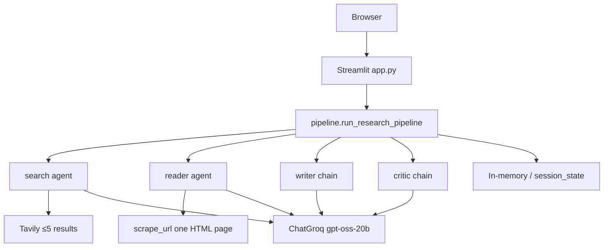
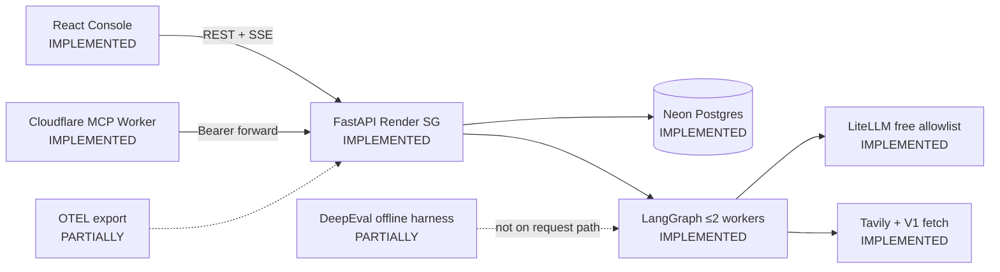
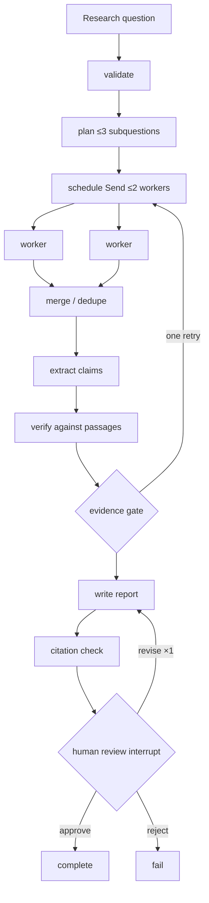
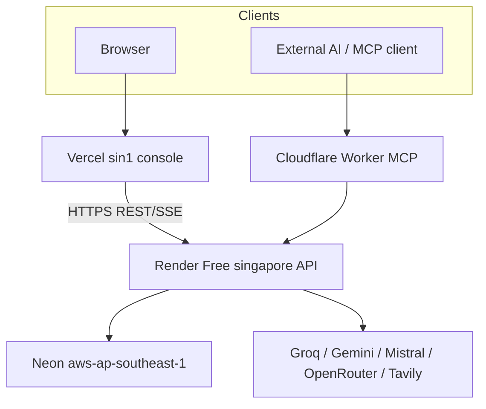

# ResearchMind 2.0 — Engineering Story

**Audit date:** 2026-11-08 (Asia/Calcutta)  
**Code baseline:** `main` @ `fa0f544` (includes PR #8 Codex P2 + public hygiene)  
**Authoritative product/architecture spec:** [`../RESEARCHMIND_2_0_SOURCE_OF_TRUTH.md`](../RESEARCHMIND_2_0_SOURCE_OF_TRUTH.md)  
**Live execution status:** [`../IMPLEMENTATION_STATUS.md`](../IMPLEMENTATION_STATUS.md)  
**Measured hosts:** [`../deployment-report.md`](../deployment-report.md)

This folder is the portfolio engineering narrative for ResearchMind. It explains what V1 was, what bottlenecks the code actually had, why V2 was designed the way it was, what is implemented versus planned, and which metrics remain unmeasured.

**Rules used throughout:** no fabricated benchmarks; planned work is never described as shipped; every major claim is tagged with an implementation status.

### Status vocabulary

| Tag | Meaning |
|---|---|
| **IMPLEMENTED** | Present in the repository |
| **VERIFIED** | Covered by automated tests or a recorded offline/live check |
| **PARTIALLY IMPLEMENTED** | Code exists; requirements remain |
| **PLANNED** | Approved architecture, not built (or not finished) |
| **EXPERIMENTAL** | Being evaluated |
| **NOT IMPLEMENTED** | Absent |
| **DEFERRED** | Deliberately postponed |
| **NOT MEASURED** | No recorded metric yet |

---

## 1. Project overview

ResearchMind turns a research question into an evidence-linked draft. The original product (V1) was a Streamlit workspace with a sequential Search → Reader → Writer → Critic pipeline on Groq + Tavily. ResearchMind 2.0 keeps that V1 tree as a frozen baseline (`v1-baseline`) and adds a deployable FastAPI + LangGraph + Neon + React + Cloudflare MCP stack beside it.

**Engineering objective (not “connect agents”):** demonstrate measurable improvements in research quality, retrieval performance, reliability, execution time, resource use, and inference cost — under a student-demo budget with free-only model routing and no silent paid fallback.

### Live public URLs (Singapore)

| Surface | URL | Status |
|---|---|---|
| Research Console | https://researchmind-console.vercel.app | Documented live HTML shell |
| API | https://researchmind-api-sg.onrender.com | Documented live health/ready |
| MCP Worker | https://researchmind-mcp.jadhavsumit534.workers.dev | Documented deployed forwarder |
| Neon | `aws-ap-southeast-1` project `lively-star-88380432` | Wired as API `DATABASE_URL` |

Cold-start latency, RSS, hosted research-run p95, and DeepEval judge scores are **NOT MEASURED**.

---

## 2. Original implementation (V1)

| Layer | Behavior | Evidence |
|---|---|---|
| UI | Streamlit (`v1/app.py`), session-scoped state | `v1/app.py` |
| Orchestration | Sequential `search → reader → writer → critic` | `v1/pipeline.py` `STAGES`, `run_research_pipeline` |
| Models | Single Groq `openai/gpt-oss-20b` for every stage | `v1/agents.py` `build_llm` |
| Search | Tavily, `max_results=5` | `v1/tools.py` `web_search` |
| Reading | Prompted to scrape **one** HTML URL; no PDF | `v1/agents.py` `build_reader_agent`; `v1/tools.py` `scrape_url` |
| Critic | Same-model review; not passage-grounded verification | `v1/agents.py` critic prompt |
| Recovery | `PipelinePaused` + manual Resume; in-memory / Streamlit session | `v1/pipeline.py`, `v1/app.py` |
| Tests | 14 offline unittest cases; providers mocked | `tests/`, `.github/workflows/tests.yml` |

V1 is frozen at tag `v1-baseline` → `f1881b9`. See [`../BASELINE_REPORT.md`](../BASELINE_REPORT.md).

### Original architecture

All nodes above are **IMPLEMENTED** in V1. None of the V2 durable/job/SSE pieces exist on this path.

---

## 3. Why the architecture had to evolve

Source-backed bottlenecks (details in [`bottleneck-analysis.md`](bottleneck-analysis.md)):

1. Sequential wall-clock latency (sum of four stages).
2. One deep source → weak evidence grounding.
3. Session-only state → restart/session loss.
4. Single provider → shared free-tier 429s with no approved failover.
5. Critic ≠ claim verification against stored passages.
6. Streamlit UX unsuitable as a multi-screen research workspace with replayable progress.
7. No server-side one-use quota for a public demo.
8. No evaluation harness separating fixture checks from LLM-as-judge scores.

---

## 4. ResearchMind 2.0 target architecture

| Component | Status |
|---|---|
| FastAPI + health/CORS | IMPLEMENTED · VERIFIED |
| LiteLLM SDK Router free-only | IMPLEMENTED · VERIFIED (mock); live partial |
| LangGraph evidence graph | IMPLEMENTED · VERIFIED |
| Postgres jobs/quotas/events/checkpoints | IMPLEMENTED · VERIFIED (local Postgres; Neon live wired) |
| SSE replay + React console | IMPLEMENTED · VERIFIED (unit) |
| Thin MCP Worker | IMPLEMENTED · VERIFIED · deployed |
| DeepEval scored comparison | PARTIALLY (harness only; scores NOT MEASURED) |
| OpenTelemetry collector path | PARTIALLY (code + redaction; export default off) |
| PDF parsing / pgvector / WebSockets / MCP OAuth | DEFERRED / PLANNED |
| SSRF egress proxy | PLANNED (residual risk open) |

### Research execution pipeline (implemented bounds)

Ceilings live in `backend/app/graph/limits.py` (`GraphLimits`): ≤3 subquestions, ≤2 workers, ≤6 sources, ≤4 searches, 1 evidence retry, 1 revision, PDF off.

### Infrastructure deployment

---

## 5. Main engineering decisions

| Decision | Why | Doc |
|---|---|---|
| LiteLLM **SDK Router inside FastAPI**, not Proxy | Avoid second process/RAM on Render Free | [`architecture-and-decisions.md`](architecture-and-decisions.md), ADR 0002 |
| Free-only allowlist; fail closed on paid | Student budget; no silent top-up | [`provider-routing-and-failover.md`](provider-routing-and-failover.md) |
| LangGraph `Send` ≤2 workers | Bounded parallelism without thrashing free quotas | [`research-pipeline-and-agent-architecture.md`](research-pipeline-and-agent-architecture.md) |
| Neon + in-process queue consumer | Durable jobs without paid Redis/worker | [`deployment-and-infrastructure.md`](deployment-and-infrastructure.md), ADR 0004 |
| SSE + REST, not WebSockets | Replayable progress; one-way updates enough | [`streaming-and-parallel-execution.md`](streaming-and-parallel-execution.md) |
| DeepEval offline only | Eval cost ≠ every public request | [`evaluation-strategy.md`](evaluation-strategy.md) |
| Thin MCP Worker | Edge auth/limits; graph stays in FastAPI | [`provider-and-mcp-integration.md`](provider-and-mcp-integration.md) |
| No pgvector in first release | Per-run evidence store, not a corpus RAG product | [`retrieval-and-evidence-engine.md`](retrieval-and-evidence-engine.md) |

---

## 6. Optimization experiments and evaluation

Experiment register: [`optimization-and-experiments.md`](optimization-and-experiments.md).  
Most experiments remain **PLANNED** or **NOT MEASURED**. Deterministic eval fixtures pass (`dataset=32`, `runs=20`, `fixture_mismatches=0`); LLM-judge scores are **NOT MEASURED** ([`../evals/RESULTS.md`](../evals/RESULTS.md)).

---

## 7. Deployment architecture (honest)

Profile A (approved): one Render Free Docker web service (`WEB_CONCURRENCY=1`), Neon Postgres, Vercel static console, Cloudflare Workers MCP. Jobs and checkpoints live in Neon; the container filesystem is ephemeral. Render Free spins down after ~15 minutes idle and wakes in ~1 minute ([Render free docs](https://render.com/docs/free), verified 2026-11-08).

---

## 8. Current development status (summary)

| Area | Status |
|---|---|
| V1 baseline frozen | VERIFIED offline (14 tests) |
| V2 backend | IMPLEMENTED · VERIFIED offline (documented peak 95 backend tests) |
| React console | IMPLEMENTED · VERIFIED (16 unit tests + build) |
| MCP Worker | IMPLEMENTED · VERIFIED (29 tests) · deployed |
| Singapore public stack | Documented live |
| End-to-end live research quality scores | NOT MEASURED |
| Cold-start / RSS / cost USD | NOT MEASURED |
| SSRF fully closed | NOT IMPLEMENTED (residual) |

---

## 9. Document index

| # | Document | Focus |
|---|---|---|
| A | [README.md](README.md) | This overview |
| B | [architecture-and-decisions.md](architecture-and-decisions.md) | Technology selection ADRs |
| C | [bottleneck-analysis.md](bottleneck-analysis.md) | V1 bottlenecks with evidence |
| D | [research-pipeline-and-agent-architecture.md](research-pipeline-and-agent-architecture.md) | LangGraph workflow |
| E | [provider-routing-and-failover.md](provider-routing-and-failover.md) | LiteLLM multi-provider |
| F | [retrieval-and-evidence-engine.md](retrieval-and-evidence-engine.md) | Search, evidence, claims |
| G | [frontend-and-user-experience.md](frontend-and-user-experience.md) | React console vs Streamlit |
| H | [streaming-and-parallel-execution.md](streaming-and-parallel-execution.md) | SSE, workers, events |
| I | [provider-and-mcp-integration.md](provider-and-mcp-integration.md) | Remote MCP |
| J | [evaluation-strategy.md](evaluation-strategy.md) | DeepEval + deterministic metrics |
| K | [benchmarking-and-performance.md](benchmarking-and-performance.md) | Reproducible measurement |
| L | [cost-and-resource-optimization.md](cost-and-resource-optimization.md) | Student budget |
| M | [deployment-and-infrastructure.md](deployment-and-infrastructure.md) | Render / Neon / Vercel / Docker |
| N | [security-and-abuse-prevention.md](security-and-abuse-prevention.md) | Quotas, SSRF, injection |
| O | [observability-and-operations.md](observability-and-operations.md) | Logs, traces, ops |
| P | [optimization-and-experiments.md](optimization-and-experiments.md) | Experiment register |
| Q | [resume-and-portfolio-evidence.md](resume-and-portfolio-evidence.md) | Recruiter-safe claims |

Related ADRs: [`../ADR/`](../ADR/). Risk register: [`../RISK_REGISTER.md`](../RISK_REGISTER.md).

---

## 10. What this portfolio should prove

Anyone reviewing ResearchMind should leave knowing:

- V1 was a working sequential Streamlit research demo with real SSRF-aware fetch and resume UX.
- V2 was engineered for durable jobs, free-only multi-provider routing, evidence-linked reports, SSE visibility, guest abuse controls, and a public Singapore deploy — **without** claiming production SLA, closed SSRF, or unmeasured quality wins.
