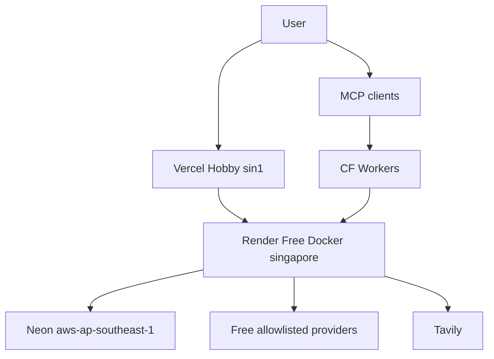

# Deployment and infrastructure

**Deployment is definition-of-done** for ResearchMind 2.0 (SoT).  
**Live Singapore profile:** documented in [`../deployment-report.md`](../deployment-report.md)  
**Artifacts:** `Dockerfile`, `infra/docker-entrypoint.sh`, `render.yaml`, `vercel.json`, `mcp-server/wrangler.jsonc`, `.github/workflows/` (`tests.yml`, `deploy-mcp-worker.yml`, `keep-api-awake.yml`)  
**External doc check:** Render / Neon / Cloudflare / Vercel — 2026-11-08

---

## Target topology

| Surface | URL | Status |
|---|---|---|
| Console | https://researchmind-console.vercel.app | Live HTML shell documented |
| API | https://researchmind-api-sg.onrender.com | Live health/ready documented |
| MCP | https://researchmind-mcp.jadhavsumit534.workers.dev | Deployed forwarder documented |
| Neon | `lively-star-88380432` | Wired |

Oregon/US experiments were deleted (user request for Singapore).

---

## Render investigation

| Topic | Finding (docs 2026-11-08) | ResearchMind approach |
|---|---|---|
| Free Web Services | 0.1 CPU / 512 MB; sleep 15 min idle; ~1 min wake; 750 instance-hours/mo | Accepted for Profile A |
| Starter/Standard | Paid; no sleep | Upgrade only if measured |
| Docker | Supported | `Dockerfile` + entrypoint |
| Persistent disk | Not on Free | Neon only |
| Background workers | Separate service / paid concerns | **In-process** queue consumer |
| SSE | HTTP long-lived; sleep still applies | Durable events in Neon |
| Health checks | Supported | `/api/v1/health/live` |
| Ephemeral FS | Yes | No critical data on disk |
| `WEB_CONCURRENCY` | Must be 1 | Entrypoint refuses otherwise |
| Region | singapore | `render.yaml` (service `researchmind-api-sg`, `plan: free`, `autoDeployTrigger: commit`, `numInstances: 1`) |

Free Render Postgres expires ~30 days — **rejected** in favor of Neon.

### Job durability pattern — IMPLEMENTED

1. `POST` run inserts `research_jobs` + idempotency key; returns 202.  
2. Lifespan `QueueConsumer` leases with `FOR UPDATE SKIP LOCKED`.  
3. Heartbeats; expired leases and stranded jobs recover periodically; a lost lease stops the graph.  
4. LangGraph checkpoints in Postgres.  
5. Events append for SSE replay.  
6. Restart mid-LLM → at-least-once (documented).  

Not used: in-memory queues, FastAPI BackgroundTasks as sole durability, temp FS for jobs.

---

## Neon investigation

| Topic | Free plan (docs 2026-11-08) |
|---|---|
| Compute | 100 CU-hours/project/month; scale to zero after 5 min |
| Storage | 1 GB/project; 20 GB account cap |
| Pooling | PgBouncer available; checkpointer may need direct URL — **NOT MEASURED** which string is used in prod beyond “DATABASE_URL set” |
| pgvector | Available in Neon generally; **not used** by ResearchMind first release |

Hitting CU-hours suspends compute until next period or upgrade — data not auto-deleted per Neon FAQ notes.

---

## Vercel investigation

| Topic | Notes |
|---|---|
| Hobby static SPA | `vercel.json` builds `frontend/` into `frontend/dist`; console served under `/app`, portfolio landing at `/` |
| Env | `VITE_API_BASE`, `VITE_TURNSTILE_SITE_KEY` only |
| SSE | Browser talks to **Render**, not through Vercel functions |
| CORS | API must allow exact console origin |
| Region | `sin1` per deployment-report; not set in `vercel.json` |

---

## Docker

| Item | Detail |
|---|---|
| Base | Python 3.13 slim |
| Deps | `backend/requirements.txt` only (no V1 code, no `requirements-fetch.txt`; fetch lives in `backend/app/research/fetch.py`) |
| User | uid 10001 |
| Start | `infra/docker-entrypoint.sh` → Uvicorn `backend.app.main:app` |
| Port | `$PORT` |
| Healthcheck | none in Dockerfile; Render uses `healthCheckPath: /api/v1/health/live` |
| CI | `docker` job runs `docker build .` (no push) |

---

## Platform comparison (selection rationale)

| Platform | Python+Docker | SSE | Free durable DB story | Selected? |
|---|---|---|---|---|
| Render + Neon | Yes | Yes | Neon ongoing free caps | **Yes** |
| Railway | Yes | Yes | Usage-based; not first pick | Alternative |
| Fly.io | Yes | Yes | More ops; not first pick | Alternative |
| Streamlit Cloud | V1 only (V1 is not currently deployed) | N/A | N/A | V1 baseline only |

Do not pick a host only because marketing says “free.” Render Free sleep and Neon CU-hours are real limits.

---

## Zero-cost prototype vs interview-demo minimum

| Profile | Config |
|---|---|
| **A — zero-cost prototype** | Render Free + Neon Free + Vercel Hobby + CF Free + free models + mock optional |
| **B — interview reliability** | Same topology; consider paid Render to avoid sleep; pre-warm URL; verified live models; Turnstile on |

Cold start, RSS, and hosted p95 remain **NOT MEASURED**.

---

## Deployment checklist / smoke test

1. `GET /api/v1/health/live` → 200  
2. `GET /api/v1/health/ready` → database ok  
3. Console loads; no provider keys in JS bundle  
4. Guest + Turnstile (if configured)  
5. One short run → 202 → SSE events  
6. Refresh → replay  
7. Second run same guest → quota error  
8. MCP read tool with bearer (optional)  
9. Record URLs, region, plan, and any **measured** cold-start in deployment-report  

Secrets stay in host dashboards — never in git.

---

## Deployment risks

| Risk | Mitigation |
|---|---|
| Render sleep | Banner in UI; Neon durability; Worker cron pings `/api/v1/health/live` every 10 min (`mcp-server/wrangler.jsonc`); `keep-api-awake.yml` is manual-only because GitHub throttled its schedule |
| Neon scale-to-zero + Render wake | Compounded latency — NOT MEASURED |
| Single Uvicorn worker | Simplicity; no HA |
| Gemini alias unverified | Live smoke before demos |
| SSRF residual | Risk register; no “secure egress” claim |
| Docs drift (M7 “not deployed” vs live URLs) | Prefer deployment-report + status gate header |
