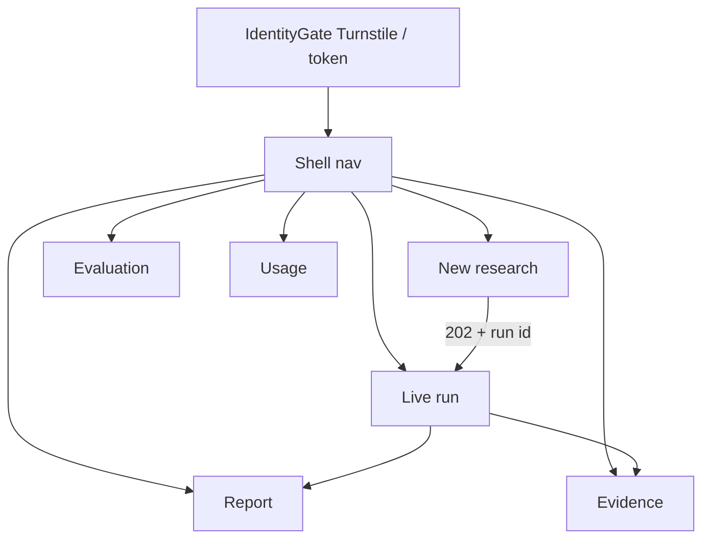

# Frontend and user experience

**V1 UI:** Streamlit `app.py` (baseline only — **not** the ResearchMind 2.0 frontend)  
**V2 UI:** React + TypeScript + Vite under `frontend/` — **IMPLEMENTED · VERIFIED** (lint, typecheck, 16 unit tests, production build)  
**Live:** https://researchmind-console.vercel.app (`sin1`)

---

## Why leave Streamlit

| Streamlit V1 | Need for V2 |
|---|---|
| Single script + session state | Durable runs across refresh |
| `st.status` progress | Replayable SSE timeline |
| Tabs Report/Critic/Source | Evidence explorer + evaluation + usage |
| Secrets in Streamlit Cloud | Zero provider keys in browser |
| Hard to style as a multi-route workspace | Explicit routes and components |

Streamlit remains in-repo for regression comparison, not as the public V2 surface.

---

## Stack

| Layer | Choice | Status |
|---|---|---|
| React 19 + TS + Vite | SPA | IMPLEMENTED |
| Utility-style CSS in `index.css` + local primitives (Tailwind removed 2026-11-10) | Lightweight design system | IMPLEMENTED |
| shadcn/ui | Recommended in brief; console uses local `components/ui.tsx` rather than a full shadcn tree | PARTIAL / pragmatic |
| Charts | Recharts available; evaluation page shows **not measured** | IMPLEMENTED (no fake scores) |
| SSE | `@microsoft/fetch-event-source` (Bearer headers) | IMPLEMENTED · VERIFIED |

---

## Information architecture



Routes owned in `frontend/src/App.tsx`.

### Screens

#### 1. Research dashboard / New research — `NewResearchPage.tsx`
- Topic input, quick examples  
- Server budgets shown read-only (guest cannot raise caps)  
- Remaining allowance via usage API  
- Cold-start banner for Render Free  

#### 2. Research configuration
- Depth/source/model knobs that would burn quota are **not** exposed as free-form expensive controls  
- Approved models are server-side; UI does not ship provider keys  

#### 3. Live execution workspace — `LiveRunPage.tsx`
- Run status, event timeline, review form, cancel  
- SSE channel via `hooks/useRunChannel.ts` + `api/sse.ts`  
- Reconciles with REST GET after refresh / visibility / drop  

#### 4. Evidence explorer — `EvidencePage.tsx`
- Sources, passages, claims, verification status  
- No invented “reliability score”  

#### 5. Research report — `ReportPage.tsx`
- Markdown via `MarkdownView` (no raw HTML; neutralize `<`)  
- Citation links to evidence  
- Export: browser print/save; dedicated PDF export **NOT IMPLEMENTED** as a first-class feature  

#### 6. Evaluation dashboard — `EvaluationPage.tsx`
- Explicitly renders metrics as **not measured**  
- No guest “run DeepEval” button  

#### 7. Usage — `UsagePage.tsx`
- Entitlement / caps snapshot  

---

## ASCII wireframe (live run)

```text
┌──────────────────────────────────────────────────────────┐
│ ResearchMind                         Usage · New · …    │
├──────────────────────────────────────────────────────────┤
│ Topic: …                                                 │
│ Status: running | awaiting_review | completed | failed   │
│ ┌─ Timeline ─────────────────────┐ ┌─ Events ─────────┐ │
│ │ planner ✓  workers ■■          │ │ snapshot          │ │
│ │ sources …  claims …            │ │ worker.started    │ │
│ │ report …                       │ │ source.found …    │ │
│ └────────────────────────────────┘ └───────────────────┘ │
│ [Cancel]     Review: [Approve] [Revise] [Reject]         │
└──────────────────────────────────────────────────────────┘
```

---

## API integration

| Concern | Approach |
|---|---|
| Auth | Guest bearer in `sessionStorage` (`auth/token.tsx`); never in URL |
| REST | `api/client.ts` |
| SSE | Header `Authorization` + `Last-Event-ID`; query token ignored by API |
| CORS | Exact origins on API (`CORS_ORIGINS`) |
| Turnstile | Public site key only (`VITE_TURNSTILE_SITE_KEY`) |

---

## UX states

| State | Behavior |
|---|---|
| Loading | Skeleton/status copy; do not invent partial scores |
| Error | Surface API error text; dead SSE ≠ failed job until REST says so |
| Empty | Prompt to start research / pass Turnstile |
| Responsive | Shell mobile menu; M4 browser check at 390px without live API |
| Accessibility | Semantic structure; improve focus labels as follow-up — not claimed WCAG-certified |

---

## Design tokens (console)

Defined in `frontend/src/index.css` (dark research workspace aesthetic already shipped). Do not regress to generic purple-gradient marketing tropes when extending UI. Prefer the existing console language.

---

## Component ownership

| Area | Files |
|---|---|
| Shell / nav | `components/Shell.tsx` |
| Identity | `components/IdentityGate.tsx` |
| Review | `components/ReviewForm.tsx` |
| Markdown | `components/MarkdownView.tsx` |
| Pages | `pages/*` |
| Domain tests | `pages/screens.test.tsx`, Markdown tests |

---

## Known frontend limits

- Production JS chunk large (~777 kB / ~235 kB gzip recorded in M4) due to Recharts + Markdown  
- No Playwright E2E against a live research run recorded  
- Publication date / worker provider fields often “unknown” unless events contain them  

V1 Streamlit must not be presented as the final V2 UX in portfolio materials.
