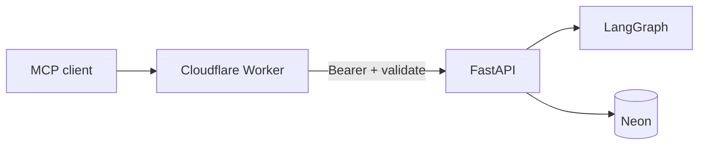

# Provider gateway vs remote MCP integration

**MCP Worker:** `mcp-server/` — IMPLEMENTED · VERIFIED (29 unit tests) · deployed  
**ADR:** [`../ADR/0006-cloudflare-mcp.md`](../ADR/0006-cloudflare-mcp.md)  
**Live:** https://researchmind-mcp.jadhavsumit534.workers.dev  
**API base:** Singapore Render API  

**Doc check:** Cloudflare Workers limits ([developers.cloudflare.com/workers/platform/limits](https://developers.cloudflare.com/workers/platform/limits/)), 2026-11-08.

---

## Vocabulary (do not conflate)

| Term | What it is | What it is not |
|---|---|---|
| **MCP server** | Tool interface for AI clients | An LLM provider |
| **MCP client** | Cursor / Claude / Inspector calling tools | ResearchMind backend |
| **MCP transport** | Streamable HTTP (Worker) | LiteLLM |
| **LiteLLM Router** | Model gateway inside FastAPI | MCP |
| **FastAPI backend** | Research engine, quotas, graph | Edge Worker logic |

An MCP server exposes **tools**. LiteLLM routes **models**. ResearchMind’s Worker only authenticates, validates, rate-limits at the edge, and **forwards** to FastAPI.

---

## Architecture

**Non-goal:** duplicate LangGraph inside the Worker (CPU 10 ms free plan would be the wrong place anyway).

### Cloudflare Free constraints (verified 2026-11-08)

| Limit | Free plan |
|---|---|
| Requests | 100,000 / day (account) |
| CPU time | 10 ms / request |
| Memory | 128 MB |
| Subrequests | 50 / request |

Forwarding + light auth fits; running research does not.

---

## Tools (`mcp-server/src/tools.ts`)

| Tool | Kind | Expensive? | Backend |
|---|---|---|---|
| `create_research_run` | write | **Yes** — starts a job | POST research run |
| `get_research_run` | read | No | GET run |
| `get_research_report` | read | No | MCP read API |
| `list_research_sources` | read | No | MCP read API |
| `get_claim_evidence` | read | No | MCP read API |
| `get_evaluation_summary` | read | No | Returns published summary with `measured: false` |

Read tools are owner-scoped via the same guest bearer the console uses. Create is subject to FastAPI quotas (one-use, global caps). Worker applies additional per-isolate edge limits (`limits.ts`).

### Forwarding rules

- Validate tool input shapes before forward.  
- Do **not** retry `create_research_run` blindly (duplicate jobs / quota).  
- Map API errors to MCP tool errors without leaking secrets.  
- `RESEARCHMIND_API_BASE` must be the public API origin (not loopback) when deployed.

---

## Authentication

| Mechanism | Status |
|---|---|
| Guest bearer token (shape check + forward) | IMPLEMENTED |
| OAuth resource server for third-party clients | **PLANNED** (ADR 0006) |
| Provider keys in Worker | **Forbidden** — keys stay on FastAPI |

---

## Testing

| Check | Status |
|---|---|
| Vitest unit tests (auth, forward, server) | VERIFIED 29/29 (documented) |
| Wrangler dry-run | Documented in status |
| MCP Inspector end-to-end | **NOT RECORDED** as run |
| Live workers.dev deploy | Documented in `deployment-report.md` |

---

## How external AI clients use ResearchMind

1. Obtain a guest identity from the API (Turnstile-gated when configured).  
2. Pass the bearer to the MCP Worker.  
3. Call read tools freely within edge/API limits.  
4. Call `create_research_run` sparingly — it consumes the demo entitlement.  
5. Poll/get run and report tools; do not expect the Worker to stream LangGraph internals.

---

## Separation from LiteLLM “providers”

Portfolio language should say:

- “Multi-provider **model** routing via LiteLLM inside FastAPI”  
- “Remote **MCP tool** access via Cloudflare Worker”

Not: “MCP provides the LLMs.”
