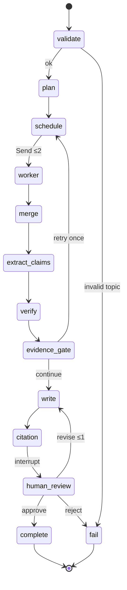

# Research pipeline and agent architecture

**Status of graph code:** IMPLEMENTED · VERIFIED (`backend/tests/test_graph_workflow.py`)  
**ADR:** [`../ADR/0003-langgraph-evidence-graph.md`](../ADR/0003-langgraph-evidence-graph.md)  
**Limits:** `backend/app/graph/limits.py` `GraphLimits`

---

## Design principle

Do **not** create autonomous agents for deterministic work. Search/fetch are fixed ports. Passage selection, citation validation, and URL dedupe are Python functions. LLMs are used where language understanding is required (plan, extract claims, write, optional verify assist) — and even then outputs are re-checked deterministically before “supported.”

---

## Target / implemented workflow

### Node responsibilities

| Node | Responsibility | LLM? | Status |
|---|---|---|---|
| `validate` | Topic length/safety gates | No | IMPLEMENTED |
| `plan` | ≤3 subquestions | Yes (`rm-planner`) | IMPLEMENTED |
| `schedule` | Emit `Send` to ≤2 workers | No | IMPLEMENTED |
| `worker` | Search + fetch via ports; return isolated results | No | IMPLEMENTED |
| `merge` | Dedupe canonical URL / content hash | No | IMPLEMENTED |
| `extract_claims` | Atomic claims from evidence | Yes (`rm-researcher`) | IMPLEMENTED |
| `verify` | Ground claims to passages | Yes (`rm-verifier`) + deterministic overlap | IMPLEMENTED |
| `evidence_gate` | One follow-up search (needs a free source slot; skips known URLs) or continue with gaps | No (policy) | IMPLEMENTED |
| `write` | Markdown report with citations | Yes (`rm-writer`) | IMPLEMENTED |
| `citation` | Deterministic citation validate | No | IMPLEMENTED |
| `human_review` | `interrupt` approve / revise×1 / reject | No | IMPLEMENTED |
| `complete` / `fail` | Terminal statuses | No | IMPLEMENTED |

DeepEval quality evaluation is **offline** (not a graph node on the public path). See [`evaluation-strategy.md`](evaluation-strategy.md).

---

## State schema (conceptual)

Persisted artifacts also map to SQL tables (`research_jobs`, `research_sources`, `evidence_passages`, `research_claims`, `research_reports`, `job_events`, `usage_ledger`). Graph state (LangGraph) carries working fields for the in-flight run; checkpoints store interruptible progress.

Key contracts (Pydantic in `backend/app/schemas/research.py`):

- Topic string ≤500 chars  
- Subquestions list length ≤3  
- Sources with canonical URL, title, excerpt, fetch status  
- Passages with stable ids and quotes  
- Claims with assessment `supported | contradictory | insufficient | …` only when evidence ids resolve  
- Report markdown + citation map  
- `owner_id` present; authorization enforced at HTTP/job layer (M3+)

Wording rule: reports say **evidence assessed**, not “fact-checked.”

---

## Parallel workers (`Send`)

LangGraph `Send` fans out worker nodes. Each scheduling step emits **at most two** workers (`max_parallel_workers=2`).

### When parallelism helps

- Independent subquestions that hit different queries/URLs  
- Network-bound search/fetch overlapping wall-clock  

### When parallelism hurts

- Shared free-tier RPM across workers → synchronized 429s  
- Each fetch is a blocking socket call with a 15 s overall read deadline (`research/fetch.py`), so slow pages hold a worker thread  
- Render Free 0.1 CPU / 512 MB — concurrent HTML parse spikes RAM  
- Duplicate Tavily spend without better unique sources  

**Decision:** bound at 2; measure before raising (experiment register).

---

## Error propagation and retries

| Failure | Behavior |
|---|---|
| Invalid topic | Fail closed before providers |
| Provider timeout / unavailable | Mapped by `ModelClient`; may use one allowlisted fallback; else fail/preserve |
| Malformed planner JSON | Rejected; tested |
| Search failure | Not approvable; fail path |
| Evidence gap | One retry wave, then visible gap section |
| Citation invent | Deterministic reject before review |
| Human revise past the limit | Returns to review with a warning; approve/reject stay available |
| Wall clock exceeded | Checked between graph steps; status `expired`, stop reason `wall_clock` |
| Process crash mid-LLM | Job may re-lease; provider call can run again (**at-least-once**) |

Router `num_retries=0` — avoid blind re-bill of timed-out generations. Fallbacks are explicit allowlisted hops only.

---

## Checkpointing and resume

| Mode | Behavior | Status |
|---|---|---|
| Memory saver | Dev/tests without DB | IMPLEMENTED |
| Postgres saver | Durable interrupt/resume | IMPLEMENTED · VERIFIED on local Postgres |
| Neon production | Wired via `DATABASE_URL` | Live wired; Neon-specific reopen **NOT MEASURED** in writing |

Human review resume goes through job commands (`approve` / `revise` / `reject`) which continue from checkpoint (`graph/runner.py`).

---

## Partial output preservation

Job events and persisted sources/claims/report rows are written through the executor/persist path so SSE clients can show progress. Cancel after provider work starts consumes the one-use entitlement (no refund). Cancel/fail before `provider_work_started` can refund (quota rules).

---

## V1 vs V2 pipeline comparison

| | V1 | V2 |
|---|---|---|
| Stages | 4 sequential | Graph with fan-out + gates |
| Sources deeply read | ~1 | ≤6 with passages |
| Verification | Critic prose | Claim ↔ passage |
| Human review | Manual Streamlit resume after pause | LangGraph interrupt + API |
| Durability | Session | Postgres |
| Eval node | None | Offline only |

---

## Non-goals inside the graph

- Arbitrary tool-calling agents that choose tools from page text  
- Unbounded research loops  
- Paid model escalation  
- Vector memory across runs (first release)
