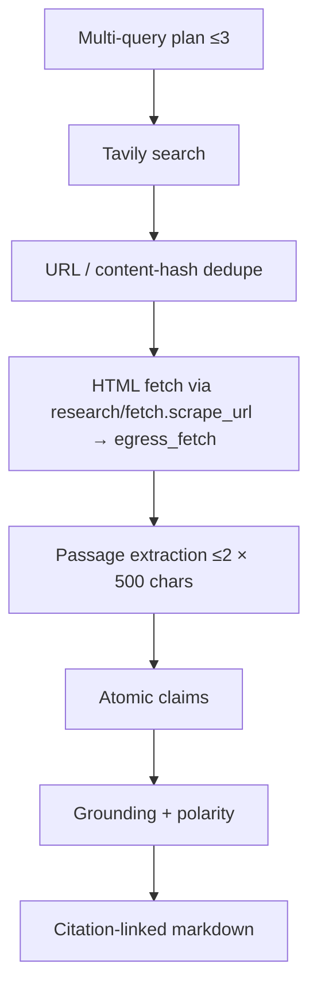

# Retrieval and evidence engine

**Code:** `backend/app/research/retrieval.py`, `backend/app/research/evidence.py`, `backend/app/research/fetch.py`, `backend/app/security/egress_fetch.py`  
**Tests:** `backend/tests/test_retrieval.py`, `test_citations.py`  
**Limits:** `GraphLimits` in `backend/app/graph/limits.py`

---

## Product shape: per-run evidence, not a corpus RAG

ResearchMind stores evidence **for a research run**, not a large persistent document collection for cross-run semantic search.

| Use case | Needed? | Decision |
|---|---|---|
| Small research-run evidence storage | Yes | Postgres tables + graph state |
| Large persistent document collections | No (v1 of V2) | DEFERRED |
| Cross-run knowledge retrieval | No | DEFERRED |
| Hybrid BM25 + embeddings + RRF + rerank | Not required to ship demo | DEFERRED |
| pgvector | Tempting but unjustified | **Rejected for first release** (SoT / ADR 0001) |

Adding a vector database would increase Neon storage, embedding cost/latency, and eval surface without solving the core demo: bounded web research with citeable passages.

---

## Pipeline

### Multi-query retrieval — IMPLEMENTED

Planner emits ≤3 subquestions. Workers search with capped `max_search_results` (≤3 per call) and `max_search_calls` ≤4 across the run.

### Source selection and dedupe — IMPLEMENTED

Merge node dedupes by canonical URL and content hash. `max_sources` ≤6. Prompt passages are taken round-robin across sources so follow-up evidence is used; the evidence retry needs a free source slot and skips known URLs.

### Domain diversity / publication dates — PARTIAL / UNKNOWN

UI may show unknown publication date unless a stored field exists (`IMPLEMENTATION_STATUS` M4). No separate domain-diversity scorer is claimed as objective truth.

### HTML extraction — IMPLEMENTED

Uses `scrape_url` in `backend/app/research/fetch.py` (moved out of V1 `tools.py` 2026-11-10; the backend no longer imports V1): `egress_fetch.fetch_public_url` resolves each hop once, dials that IP, re-checks redirects, caps the body at 1 MB with a 15 s overall read deadline, then script/style/nav strip and a 6000-char text bound.

### PDF extraction — DEFERRED

PDF URLs keep search snippet and are marked snippet-only (`pdf_enabled=False`).

### Document size limits — IMPLEMENTED

Fetch and passage ceilings as above; topic ≤500 chars.

---

## Claims and verification

| Concept | Behavior | Status |
|---|---|---|
| Atomic claims | Extracted then stored with evidence ids | IMPLEMENTED |
| Evidence references | Claim → passage id must resolve | IMPLEMENTED · VERIFIED |
| `supported` | Requires stored passage + term overlap (`claim_grounded` / `_report_match_terms`) | IMPLEMENTED · VERIFIED |
| Contradictory evidence | Assessment path + tests | IMPLEMENTED · VERIFIED |
| Insufficient evidence | Gap section after one retry | IMPLEMENTED |
| Citation mapping | Deterministic validate before human review | IMPLEMENTED · VERIFIED |

Reports must not invent citation ids. Codex P2 work tightened polarity / supported findings behavior on `fix/codex-p2-followups` (merged via PR #8).

**Honesty rule:** do not present an LLM-generated “source quality score” as objectively verified. The console avoids fake reliability badges.

---

## Example data schemas (logical)

Aligned with migration `0001_identity_jobs_quota.sql` and Pydantic schemas:

### ResearchRun
`id`, `owner_id`, `topic`, `status`, `created_at`, `lease_owner`, `attempt`, budgets, cancel flag, review state.

### Source
`id`, `run_id`, `url`, `canonical_url`, `title`, `snippet`, `fetch_status`, `content_hash`, `http_status?`.

### EvidencePassage
`id`, `source_id`, `quote`, `char_start?`, `char_end?`, `ordinal`.

### ResearchClaim
`id`, `run_id`, `text`, `assessment`, `evidence_passage_ids[]`, `notes?`.

### ClaimVerification
Logical result of verify node: assessment + linked passage ids + overlap proof; persisted via claim row fields rather than a separate marketing “fact-check” table.

### ReportCitation
Inline citation markers in markdown mapped to source/passage ids; validated by `validate_citations`.

---

## Linking claims to passages

1. Extractor proposes claims with candidate evidence ids.  
2. Verifier / deterministic layer drops `supported` unless passage exists and quote overlaps claim terms.  
3. Writer may only cite ids that survive citation validation.  
4. Evidence explorer UI lists sources → passages → claims (`frontend/src/pages/EvidencePage.tsx`).

---

## SSRF note

Retrieval uses the shared in-process fetch in `egress_fetch.py`. There is no separate egress proxy (R04 open), so other sockets in the process are not filtered. See [`security-and-abuse-prevention.md`](security-and-abuse-prevention.md).

---

## Metrics

Retrieval Precision@K / Recall@K / MRR / NDCG on a frozen snapshot: **NOT MEASURED**. Methodology is in [`benchmarking-and-performance.md`](benchmarking-and-performance.md) and [`evaluation-strategy.md`](evaluation-strategy.md).
