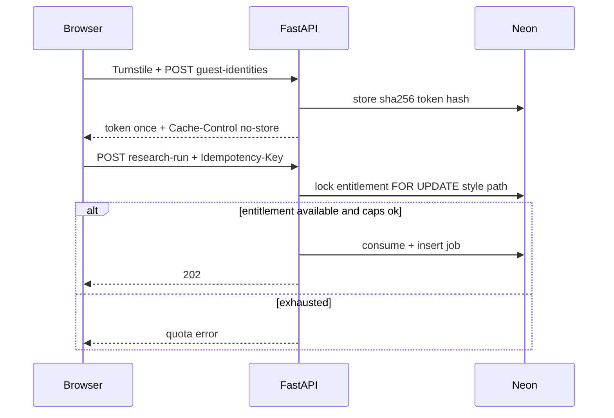

# Security and abuse prevention

**Risk register:** [`../RISK_REGISTER.md`](../RISK_REGISTER.md)  
**M3 review:** PASS WITH CONDITIONS (SSRF left open)  
**Code owners:** `backend/app/jobs/quota.py`, `turnstile.py`, `research/fetch.py`, `security/egress_fetch.py`, CORS/settings validators, MCP auth

This is a **public student demo**, not a claimed hardened multi-tenant SaaS.

---

## Controls map

| Area | Behavior | Status |
|---|---|---|
| API secrets | Server env only; `.env` gitignored | IMPLEMENTED |
| Provider keys | Never in Vite bundle / MCP Worker | IMPLEMENTED |
| Prompt injection | Untrusted delimiters; fixed tool ports; fixtures | PARTIAL |
| Indirect injection via pages | Pages cannot select tools | IMPLEMENTED intent |
| SSRF | Resolve once per hop, dial that IP with original Host/SNI, re-check redirects | PARTIAL — **not closed** |
| DNS rebinding | Residual risk without egress proxy | OPEN |
| URL validation | `egress_fetch.resolve_global_ips` / `fetch_public_url` | IMPLEMENTED · VERIFIED offline |
| Egress restrictions | No proxy | NOT IMPLEMENTED |
| HTML sanitization (fetch) | Strip script/style/nav/… | IMPLEMENTED |
| XSS (console) | `react-markdown` without raw HTML; neutralize `<` | IMPLEMENTED |
| CORS | Exact origins; credentials off | IMPLEMENTED · VERIFIED |
| Input validation | Pydantic + topic length | IMPLEMENTED |
| Request size | Fetch body caps; topic caps | IMPLEMENTED |
| DB isolation | Owner-scoped queries | IMPLEMENTED · VERIFIED |
| Sensitive logging | Redaction helpers; no secrets in tests | PARTIAL · VERIFIED offline |
| MCP auth | Bearer forward; OAuth planned | PARTIAL |
| Tool authorization | Same guest ownership on reads; create = quota | IMPLEMENTED |

---

## One-time research usage

Research burns search + multiple model calls. Abuse controls are **server-side**.

| Mechanism | Detail | Status |
|---|---|---|
| Anonymous guest identity | Random token; DB stores SHA-256 only | IMPLEMENTED |
| Turnstile | Fails closed when no secret is set; verify URL pinned to Cloudflare; no `remoteip` sent; response hostname checked against `CORS_ORIGINS` | IMPLEMENTED · VERIFIED |
| HttpOnly cookie | Not the primary design — token in `sessionStorage` + Authorization header | Design choice |
| Atomic quota | DB updates before expensive work; Codex P2 lock ordering | IMPLEMENTED · VERIFIED |
| Idempotency keys | Unique constraint | IMPLEMENTED · VERIFIED |
| IP-based limits | Not a sole trust root | PARTIAL / not primary |
| Concurrent-run restrictions | Global active cap | IMPLEMENTED |
| Per-run token/model budgets | Settings + graph limits | IMPLEMENTED |
| Daily global budget | `quota_guard` | IMPLEMENTED · VERIFIED |

### Cookie ≠ human

Clearing storage or using another browser + passing Turnstile again creates a **new** identity. True one-human enforcement needs stronger auth or access codes — **not claimed**.

### Exhausted quota behavior

API returns a clear error; prior runs remain readable for the same owner. Frontend Usage page shows allowance. No silent bypass via refresh/parallel POST (idempotency + row locks).

Refunds: only if failure occurs before `provider_work_started` is committed. Cancel after work starts still consumes entitlement.

---

## SSRF honesty

`egress_fetch.py` resolves each hop once, rejects private/loopback/link-local/metadata addresses, and dials that validated IP with the original hostname for Host/SNI, including redirect hops. Tests cover private/mixed DNS and redirect-to-private.

**Still open (R04):** any other socket in the process bypasses the check; traffic to a public IP that is still undesirable; no egress allowlist proxy. Do not document SSRF as closed.

---

## MCP

- Edge parse of bearer shape + forward  
- Per-isolate rate limits  
- No provider secrets on the Worker  
- OAuth for third-party agents: PLANNED  

---

## Logging / privacy

Avoid logging full retrieved documents, raw tokens, or API keys. Guest tokens shown once. Prefer run ids in logs.
