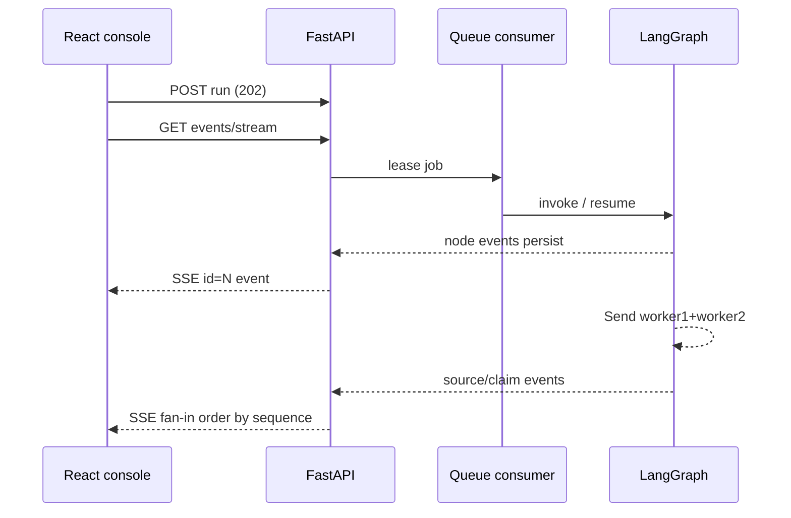

# Streaming and parallel execution

**SSE route:** `backend/app/api/v1/stream.py` — IMPLEMENTED · VERIFIED (`test_sse_stream.py`)  
**Frontend consumer:** `frontend/src/api/sse.ts`, `hooks/useRunChannel.ts`  
**SoT decision:** REST for commands; SSE for progress; no first-release WebSockets.

---

## Transport comparison

| Mechanism | Pros | Cons | ResearchMind decision |
|---|---|---|---|
| **SSE** | Simple one-way stream; HTTP friendly; replay via event ids | Browser `EventSource` cannot set Authorization headers | **Selected** — use fetch-based SSE client |
| WebSockets | Bidirectional | Ops complexity; not needed for command/event split; Free plan caveats | **DEFERRED** |
| HTTP polling | Simple | Higher latency/chatty | Fallback mental model only |
| Webhooks | Good for external systems | Signatures, retries, endpoint ownership | **DEFERRED** (not required for console) |
| LangGraph streaming | Native node updates | Must be translated to durable `job_events` for replay | Used internally → persisted events |

---

## Command vs stream split

| Action | Transport |
|---|---|
| Issue guest identity | REST POST |
| Start research | REST POST → **202** + run id |
| Cancel / approve / revise / reject | REST POST |
| Fetch snapshot / usage | REST GET |
| Live progress + replay | SSE GET `.../events/stream` |

---

## SSE requirements (implemented vs planned)

| Requirement | Status | Notes |
|---|---|---|
| Event schema | IMPLEMENTED | Typed events in job log + snapshot |
| Event identifiers | IMPLEMENTED | SSE `id` = persisted `sequence_id` |
| Heartbeats | PARTIAL | Rely on proxy/client timeouts; document host behavior |
| Reconnection | IMPLEMENTED (client) | `Last-Event-ID` + REST reconcile |
| Event replay | IMPLEMENTED | From Postgres `job_events` |
| Authentication | IMPLEMENTED | Bearer header only; **query token ignored** |
| CORS | IMPLEMENTED | Exact origin allowlist |
| Terminal states | IMPLEMENTED | completed / failed / cancelled / rejected |
| Browser handling | IMPLEMENTED | `@microsoft/fetch-event-source` |
| Deploy compatibility | ACCEPTED risk | Render Free sleep affects long watches |

### Why not put tokens in query strings

URLs leak via logs, Referer, and browser history. The API explicitly ignores query tokens for stream auth.

---

## Example event types

Names below are the **product vocabulary**. Exact string enums in code may use dotted or underscored forms — always confirm against persisted events / snapshot builder (`api/v1/snapshot.py`).

| Event | Meaning |
|---|---|
| `research.started` / job started | Run accepted and worker began |
| `planner.completed` | Plan ready |
| `worker.started` | Parallel worker began |
| `source.found` | Search hit recorded |
| `source.extracted` | Fetch/excerpt stored |
| `claim.verified` | Claim assessment updated |
| `report.generating` | Writer running |
| `evaluation.completed` | Offline-only; **not** on public path |
| `research.completed` | Terminal success |
| `research.failed` | Terminal failure |
| `snapshot` | Non-cursor bootstrap payload (no id) |

Snapshot includes report/sources/passages/claims/usage without moving the replay cursor.

---

## Parallel workers and streaming

Workers run concurrently inside the graph wave; events are **serialized** into `job_events` by sequence so the UI does not need vector clocks. Fan-in order is persistence order, not a guarantee of wall-clock completion order across hosts.

### Confidentiality

Streams must not include provider API keys, raw system prompts with secrets, or full unbounded HTML documents. Passages are already size-capped. Redaction helpers exist under `backend/app/observability/redaction.py`.

---

## LangGraph custom events → frontend

Graph nodes append events for the job log and may use LangGraph’s custom stream writer (ADR 0003). The public contract for the console is **durable job events + snapshot**, not a raw LangGraph wire protocol. That enables refresh-safe replay after Render restarts (job state in Neon).

---

## Webhooks (future)

If added: HMAC signatures, idempotency keys, bounded retries with backoff, and no delivery of secrets. Not required for the React console.

---

## Parallelism cost reminder

Raising `max_parallel_workers` above 2 without measuring free-tier RPM and RAM is likely to increase throttling and cost without proportional quality gains. See experiment register.
